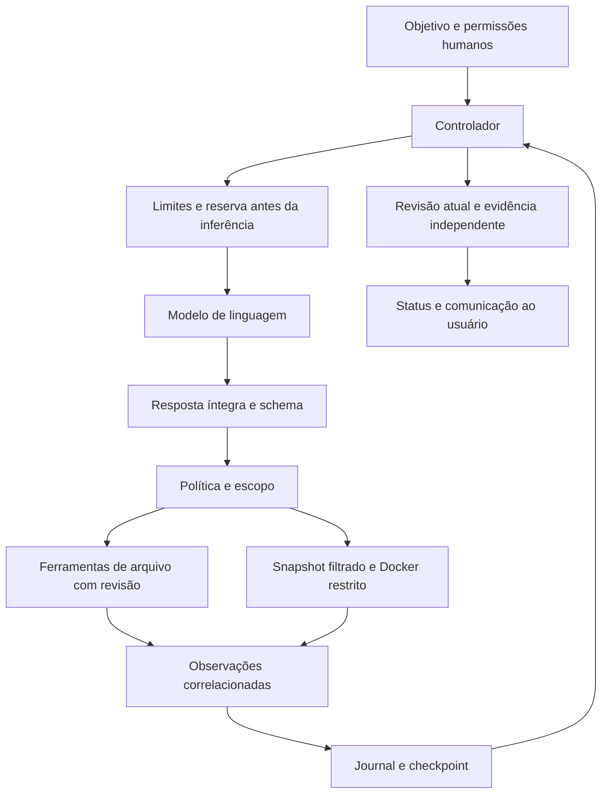

# Como construir um agente semelhante à YZZY BLACK preservando seus controles

**Extensão 0.6.0 — autoengenharia:** `/elevar` agora implementa mudanças no próprio runtime em candidata Git, verifica baseline e regressões e publica o hash aprovado. O mecanismo exige separar inferência, efeitos e publicação; congelar testes originais e controles; compartilhar orçamento; preservar mudanças humanas; e interromper efeitos incertos sem replay. `/estudar` conserva o ciclo de memória da edição 0.5.0. O [capítulo completo](docs/AUTOEVOLUCAO.md) contém algoritmo, contratos, controles, estados Git, execução no host e roteiro para outros repositórios implementarem a mesma arquitetura.

**Guia científico e de engenharia para outros projetos.** Versão documental: 4.0, de 21/10/2026, para YZZY BLACK 0.4.0. O [commit `7e1ee77`](https://github.com/codewesleylima/thinking-about/tree/7e1ee7741fb9a7330cd67a0f0bf27e92421af235) é o baseline histórico sob o nome anterior WZZY AI. ENOENT, Codex, perfis, memória e equipe são evoluções posteriores; registre a revisão ou o diff usado. O [manual de implementação](docs/replicacao/README.md) transforma as 32 seções do estudo original em fases, 30 requisitos e uma base gerável por `yzzy replicate`. O [estudo do Codex](docs/codex/README.md) preserva a pesquisa pública. A extensão CMD é opt-in e muda a confiança: shell do host não oferece as garantias do modo restrito.

## Resumo

Este documento explica como outro projeto pode compreender, reproduzir e adaptar a arquitetura da YZZY BLACK mantendo seus guardrails, contratos, métodos de execução e critérios de evidência. A unidade de construção é um sistema composto: modelo de linguagem, controlador, ferramentas, política de autorização, executor isolado, orçamento, contexto, registro de eventos e verificação. O modelo sugere ações; componentes de software controlados pelo operador decidem quais efeitos podem ocorrer.

A proposta não exige treinar um modelo do zero. Linguagem de implementação, provedor e domínio podem mudar; as propriedades de autorização, integridade, rastreabilidade e avaliação precisam ser preservadas e testadas novamente. São apresentados um modelo formal descritivo, uma matriz de controles, contratos mínimos, um roteiro de construção e um protocolo experimental. Os resultados existentes sustentam funcionamento de componentes sob condições delimitadas; não demonstram confiabilidade universal, imunidade a ataques ou equivalência a produtos comerciais.

**Palavras-chave:** agentes de linguagem; engenharia de software; uso de ferramentas; autorização; isolamento; integridade; avaliação reproduzível.

## 1. Finalidade, leitura e classificação da evidência

O público é uma equipe que queira construir um agente próprio, portar a arquitetura para outra linguagem ou aplicar os mesmos princípios em outro domínio. Para acompanhar a explicação, basta conhecer processos, APIs, arquivos, testes e controle de versão. Os termos técnicos são associados aos respectivos módulos do projeto.

Este guia complementa o [estudo original](estudo_agentes_ia_cli_arquitetura_implementacao_validacao.md), a [análise do estudo](docs/ANALISE-DO-ESTUDO.md) e os documentos operacionais. O estudo original fornece o levantamento amplo; este arquivo transforma a implementação concreta em uma referência de reprodução.

| Rótulo usado aqui | Significado | Limite da afirmação |
|---|---|---|
| Literatura | Artigo ou documentação primária consultados | Resultado pertence ao método e ambiente da fonte |
| Implementação | Comportamento identificado nos arquivos da versão indicada | Não constitui prova formal de ausência de defeitos |
| Validação registrada | Execução descrita em [VALIDACAO.md](docs/VALIDACAO.md) | Evidência histórica; reproduzir no ambiente de destino |
| Especificação de reprodução | Requisito que propomos preservar em outro projeto | Precisa de implementação e ensaio próprios |
| Evolução | Recurso desejável ainda não implementado | Não deve ser apresentado como capacidade atual |

Os modelos matemáticos deste guia descrevem decisões de engenharia. Não representam treinamento por reforço realizado pela YZZY BLACK nem uma demonstração formal de segurança do código atual.

## 2. O que está sendo reproduzido

Um LLM calcula distribuições condicionais de saída. Um agente acrescenta um ciclo em que parte dessa saída é interpretada como proposta de ação, produz observações e modifica o contexto seguinte. Uma CLI é a interface desse sistema. Nenhum desses termos, isoladamente, descreve o produto completo.

Podemos representar o sistema por:

\[
\mathcal A = (M, C, T, P, X, B, J, V)
\]

onde \(M\) é o modelo, \(C\) o controlador, \(T\) o catálogo de ferramentas, \(P\) a política, \(X\) o executor, \(B\) o orçamento, \(J\) o journal e \(V\) a verificação. Essa decomposição é nossa especificação de arquitetura. Usar o mesmo \(M\) não implica reproduzir os demais componentes ou o desempenho do sistema.

O trabalho [ReAct, de Yao et al.](https://arxiv.org/abs/2210.03629v3), investiga a combinação de ações e raciocínio em tarefas interativas. A YZZY BLACK aproveita a ideia geral de ciclos com observações; não exige registrar raciocínio privado nem reproduz integralmente o método experimental do artigo.

O estudo [SWE-agent, de Yang et al.](https://arxiv.org/abs/2405.15793v3), analisa como a interface entre agente e computador afeta tarefas de engenharia de software. Isso motiva investigar ferramentas e formato de observação como variáveis do sistema, em vez de atribuir toda diferença de qualidade ao modelo. Nenhuma pontuação desse artigo é resultado da YZZY BLACK.

### Modelo pronto, ajuste de pesos ou pré-treinamento

Na implementação atual, os pesos pertencem ao modelo selecionado. A identidade YZZY BLACK corresponde ao produto de orquestração, ferramentas e controles. Para outro projeto, o caminho inicial é integrar um modelo capaz de usar ferramentas e medir o conjunto.

Fine-tuning é uma hipótese futura quando existir falha recorrente atribuível ao comportamento do modelo, exemplos autorizados e um conjunto de avaliação separado. Pré-treinamento exige um projeto específico de dados, direitos de uso, arquitetura, computação, otimização e serving. Esses processos não são executados pelo runtime atual nem substituídos por um arquivo de instruções.

## 3. Perguntas e hipóteses verificáveis

Uma reprodução científica deve declarar o que pretende investigar antes de escolher demonstrações favoráveis. As hipóteses abaixo são propostas de ensaio, não conclusões universais.

| Hipótese | Experimento | Evidência de interesse |
|---|---|---|
| H1: a autoridade externa ao modelo contém propostas fora do escopo | Emitir chamadas válidas em forma, mas sem permissão ou com caminho proibido | Efeito negado e ausência de alteração/acesso indevido |
| H2: a revisão esperada detecta conflitos humanos | Alterar o arquivo entre leitura e tentativa de edição | Patch rejeitado e conteúdo humano preservado |
| H3: limites reduzem execução improdutiva | Repetir ferramentas, alternar chamadas e exceder o orçamento | Interrupção diagnosticável e contadores persistentes |
| H4: evidência vinculada à revisão evita aprovação desatualizada | Executar teste e depois alterar arquivo do manifesto | Evidência anterior não aprova a nova revisão |
| H5: ferramentas e contexto influenciam a solução | Comparar variantes nas mesmas tarefas com mesmo modelo e orçamento | Diferença pareada de sucesso, custo, tempo e violações |

Para H1–H4, cenários determinísticos ajudam a localizar defeitos do controlador. H5 exige inferência real, diversidade de tarefas e análise de incerteza. Uma bateria de guardrails aprovada não responde, sozinha, à pergunta sobre capacidade de programação.

## 4. Modelo de estado e ciclo causal

Considere um estado descritivo:

\[
s_t=(g, q_t, w_t, e_t, h_t, b_t, \phi_t)
\]

Aqui, \(g\) é o objetivo e suas orientações humanas; \(q_t\) representa permissões e configuração; \(w_t\) é a revisão observável do workspace; \(e_t\) reúne evidências; \(h_t\) é o histórico; \(b_t\) contém recursos consumidos/retidos; \(\phi_t\) é a fase da execução.

O modelo recebe uma projeção limitada desse estado, não acesso irrestrito ao computador:

\[
a_t \sim p_\theta(a\mid c_t),\qquad c_t=\operatorname{contexto}(s_t)
\]

A proposta só pode produzir efeito se satisfizer as verificações aplicáveis:

\[
\operatorname{executavel}(a_t)=
\operatorname{schema}(a_t)\land
\operatorname{autoridade}(a_t,q_t)\land
\operatorname{escopo}(a_t,w_t)\land
\operatorname{recursos}(a_t,b_t)
\]

Essa expressão é um contrato pretendido, sob a hipótese de que o controlador e seus validadores funcionam corretamente. No código, os checks ocorrem em etapas: reserva da inferência, validação de resposta, decisão de capacidade, validação de caminho/revisão e execução limitada. Uma simples função booleana no prompt não implementa esse contrato.



O retorno do modelo é uma proposta. O retorno da ferramenta relata uma operação. O retorno do verificador sustenta um status dentro de critérios específicos. Esses três objetos precisam continuar distintos em qualquer adaptação.

## 5. Mapa de implementação para estudar e portar

| Componente | Arquivos de referência | Responsabilidade que deve ser preservada |
|---|---|---|
| Interface | [bin/yzzy.js](bin/yzzy.js) | Objetivo, flags humanas, perguntas, cancelamento e eventos JSONL |
| Configuração | [src/config.js](src/config.js), [yzzy.config.json](yzzy.config.json) | Validação estrita, precedência explícita e fingerprint sem chave |
| Recuperação de arquivo ausente | [src/errors.js](src/errors.js) | Distinguir ausência opcional, falha recuperável e impedimento de segurança |
| Controlador | [src/agent.js](src/agent.js) | Ordem causal, correlação, limites, transições e conclusão |
| Identidade do runtime | [src/identity.js](src/identity.js) | Hash dos módulos para rejeitar retomada sob outra implementação |
| Modelo | [src/providers.js](src/providers.js) | Tradução do protocolo, uso, resposta íntegra e erros |
| Ferramentas e capacidade | [src/tools.js](src/tools.js) | Catálogo fechado, argumentos e concessão externa ao modelo |
| Arquivos e revisão | [src/workspace.js](src/workspace.js) | Escopo, caminhos, conteúdo, conflitos e snapshots |
| Processos isolados | [src/executor.js](src/executor.js) | Comando cadastrado, ambiente restrito, timeout e limpeza |
| Recursos financeiros | [src/budget.js](src/budget.js) | Reserva prévia, liquidação inteira e uso desconhecido |
| Memória operacional | [src/journal.js](src/journal.js) | Checkpoints, sequência, integridade e exclusão cooperativa |
| Saída e redação | [src/util.js](src/util.js) | Filtragem de controles do terminal e redação de padrões conhecidos |
| Experimentos | [tests/](tests/), [evaluations/](evaluations/), [scripts/](scripts/) | Casos positivos, negativos, adversariais e integração real separada |

Os diretórios são fronteiras de responsabilidade, não uma exigência de microsserviços. Outro projeto pode preservar esses contratos com APIs diferentes. O controlador usa APIs nativas de Node.js 24; a versão 0.2.0 acrescenta o Codex oficial como dependência de produção fixada no lock. [src/codex-provider.js](src/codex-provider.js), [src/codex-rpc.js](src/codex-rpc.js), [src/profiles.js](src/profiles.js) e [src/memory.js](src/memory.js) complementam esse mapa.

## 6. Modelo de ameaças e base de confiança

São ativos protegidos: arquivos humanos, credenciais, escopo de execução, saldo, integridade das evidências e histórico de ações. Entradas potencialmente hostis incluem documentos, código, saídas de teste, argumentos sugeridos pelo modelo e resultados de serviços.

O controlador, sua configuração revisada, o SO, o daemon Docker e a imagem escolhida fazem parte da base de confiança. Um operador com controle do host pode modificar esses componentes. A YZZY BLACK não oferece defesa completa contra esse adversário. O modelo pode produzir decisões erradas mesmo sem ataque deliberado.

O artigo [AgentDojo, de Debenedetti et al.](https://arxiv.org/abs/2406.13352v3), oferece um ambiente para estudar ataques e defesas de prompt injection em agentes sobre dados não confiáveis. Ele fundamenta a necessidade de ensaios adversariais; a YZZY BLACK não executou esse benchmark nem herda seus resultados.

O trabalho [Defeating Prompt Injections by Design / CaMeL](https://arxiv.org/abs/2503.18813v2) investiga separação de controle/dados e políticas por capacidades. Isso é uma referência para fortalecer a arquitetura. A YZZY BLACK atual não implementa o sistema CaMeL, rastreamento completo de fluxo de informação ou as garantias demonstradas naquele trabalho.

Uma orientação textual pode influenciar o modelo a tratar arquivos como dados, mas não elimina sua suscetibilidade semântica a uma instrução maliciosa. As barreiras determinísticas devem limitar os efeitos mesmo quando uma proposta indevida é produzida. Informação sensível em um arquivo permitido ainda pode chegar ao provedor: essa possibilidade precisa ser considerada na preparação do workspace.

## 7. Guardrails que uma reprodução precisa preservar

### 7.1 Autoridade, instruções e interfaces

| Controle atual | Onde é aplicado | Como preservar em outro projeto |
|---|---|---|
| Leitura como padrão | CLI e `decide` | Conceder escrita/execução somente por canal humano/configuração confiável |
| `--allow-write` e `writeRoots` | Política e `Workspace.resolve` | Exigir simultaneamente capacidade e caminho dentro do escopo |
| `--allow-exec` e comando cadastrado | Política e executor | Modelo seleciona nome permitido; operador define os argumentos reais |
| Orientação não concede autoridade | Prompt operacional, configuração e executor | Texto de `YZZY.md`, arquivo ou resultado não modifica concessões |
| Catálogo fechado de dez ferramentas | `tools` e `validateCall` | Ferramentas desconhecidas e campos extras falham antes do efeito |
| Correlação de chamadas | Controlador e adaptador | IDs não vazios/duplicados e resultado associado à proposta correta |
| Propostas íntegras | Adaptadores | Rejeitar resposta incompleta e JSON parcial; não executar fragmentos |
| Pergunta isolada | Controlador | `ask_user` suspende; resposta humana não é simulada por arquivo/ferramenta |
| Sem retry automático | Adaptadores/controlador | Falha não pode gerar reenvio silencioso com possível custo/efeito duplicado |
| Saída tratada como não confiável | `clean`, `redact` e CLI | Filtrar controles no terminal e manter JSONL separado de apresentação |

O catálogo atual contém `list_files`, `search`, `read_file`, `read_lines`, `replace_text`, `create_file`, `run_check`, `ask_user`, `read_documentation` e `run_command`. A última exige `--allow-host-shell` e permite comandos com privilégios do usuário, inclusive efeitos que as ferramentas restritas não oferecem. Não possui confinamento por paths/egress; não é um atalho que preserve a sandbox. O [contrato de execução](docs/replicacao/05-CMD-E-EXECUCAO.md) explica política, ensaios e efeito incerto. Sem essa concessão, permanece o modo restrito.

O prompt em `SYSTEM` orienta leitura antes de edição, evidência, preservação de alterações humanas, adaptação após erro e comunicação de limitações. `YZZY.md` da raiz é orientação adicional, congelada na sessão. Não há descoberta recursiva de instruções, hooks, skills executáveis ou plugins. Ao portar, preserve essa distinção entre orientação comportamental e poder de execução.

### 7.2 Caminhos, arquivos e mudanças humanas

| Controle atual | Efeito pretendido | Limite relevante |
|---|---|---|
| Caminhos relativos com `/` | Evitar escapes explícitos do workspace | Não é confinamento do processo controlador pelo SO |
| Rejeição de `..`, caminho absoluto, ADS, nomes reservados e caracteres ambíguos | Evitar interpretações divergentes de caminho | Semântica precisa ser revalidada em cada plataforma |
| Rejeição de symlink, junction, hardlink e arquivo especial | Evitar acesso indireto a alvos externos | Validação por syscalls não elimina toda corrida de filesystem |
| Exclusão de diretórios de controle/dependências | Reduzir exposição e volume de cópia | Não substitui política de classificação de todos os dados |
| Bloqueio de nomes comuns de segredo | Evitar leitura/cópia de credenciais reconhecidas | Um arquivo com nome comum pode conter segredo não reconhecido |
| Proteção de arquivos de controle e `evaluations/` contra escrita | Preservar política e avaliação do próprio repositório | Testes do projeto em `tests/` podem ser editáveis |
| Hash esperado e ocorrência única | Detectar edição baseada em leitura antiga ou ambígua | Não é compare-and-swap atômico contra host malicioso |
| Temporário, sincronização, nova checagem e rename | Reduzir gravação parcial no arquivo substituído | Crash ainda exige inspeção; o journal não é transação do filesystem |
| Criação exclusiva com `wx` | Impedir sobrescrita por `create_file` | Falha durante a gravação pode deixar efeito incerto |
| UTF-8 e preservação de CRLF/BOM nos casos ensaiados | Evitar alteração incidental de codificação | Arquivos binários não são editados por essas ferramentas |

O conjunto de diretórios excluídos está em `deniedDirs`: `.git`, `.yzzy`, `.aws`, `.ssh`, `.azure`, `.config`, `.agents`, `.codex`, `.github`, `node_modules`, `coverage`, `.venv`, `venv` e `__pycache__`. A expressão `sensitive` cobre, entre outros, `.env`, `.npmrc`, `.pypirc`, nomes de credenciais/chaves e extensões `.pem`, `.key`, `.p12` e `.pfx`. Consulte o código para a regra exata; uma lista resumida em documentação não deve virar a política executável.

`yzzy.config.json`, `YZZY.md`, `AGENTS.md`, o arquivo de configuração explicitamente selecionado e os caminhos sob `evaluations/` recebem proteção de escrita conforme as regras de `Workspace.resolve`. A aplicação não interpreta `.gitignore` arbitrário como uma política universal de confidencialidade.

Para formalizar o conflito de edição, sejam \(f_0\) os bytes lidos e \(f_t\) os bytes observados antes da gravação:

\[
\operatorname{admitir\_edicao}\Rightarrow
H(f_t)=H(f_0)\land
\operatorname{ocorrencias}(texto\_antigo,f_t)=1
\]

O algoritmo verifica essas condições e revalida antes do rename. A pequena janela entre validação e operação final permanece uma limitação conhecida. Um fork não deve converter esse mecanismo em uma alegação de proteção absoluta contra concorrência hostil.

### 7.3 Isolamento do código do projeto

O snapshot é uma cópia filtrada dos arquivos permitidos. O comando executa sobre essa cópia, não sobre o checkout original. O controlador fornece os argumentos via array, com `shell:false`, e configura Docker com:

```text
--pull=never
--network=none
--read-only
--cap-drop=ALL
--security-opt=no-new-privileges
--user 65534:65534
--memory 512m
--cpus 1
--pids-limit 64
--tmpfs /tmp:rw,noexec,nosuid,size=64m,mode=1777
--mount type=bind,source=<snapshot>,target=/workspace,readonly
--workdir /workspace
--env HOME=/tmp
```

A semântica dessas opções é documentada pelo [Docker](https://docs.docker.com/engine/containers/run/). A aplicação usa imagem fixada por digest em `yzzy.config.json`, sem pull implícito. Outro projeto pode usar imagem de outra linguagem, desde que mantenha isolamento equivalente, dependências preparadas, digest registrado e testes de fronteira.

Não monte home, checkout completo, journal, credenciais ou socket Docker no container. Não passe a chave do provedor por `--env`. O daemon ainda usa as credenciais necessárias ao seu funcionamento no host; a restrição descrita se refere ao ambiente do código executado. A imagem selecionada também não pode trazer segredos embutidos.

Timeout e cancelamento encerram o cliente de execução e iniciam remoção do container pelo nome específico. A aprovação depende de limpeza conhecida. Uma finalização abrupta do controlador pode impedir o `finally`; nesse caso, confira o container e os arquivos antes de abrir nova sessão. Container, daemon e kernel não constituem uma prova de impossibilidade de escape. O controlador continua sendo um processo do host.

### 7.4 Recursos, contexto, credenciais e endpoints

| Categoria | Controle a preservar |
|---|---|
| Configuração | Campos desconhecidos rejeitados; limites inteiros positivos; comando como array `argv` |
| Endpoints | Ollama restrito a loopback; OpenAI ao endpoint previsto; URL sem credenciais/query/fragmento |
| HTTP | Redirect rejeitado; prazo de requisição; teto de resposta; corpo de erro não ecoado indiscriminadamente |
| Chave | Ambiente do controlador; não incorporada ao config nem transmitida ao executor do projeto |
| Recursos locais | Teto de bytes, arquivos visitados, contexto, chamadas e tempo; truncamento explícito |
| Gasto de API | Preço com fonte/data, reserva anterior ao despacho e retenção de uso desconhecido |
| Repetição | Assinatura de ferramenta/argumentos na janela recente; limites globais permanecem ativos |
| Memória | Transcript preservado; projeção extrativa registrada; interrupção se o contexto projetado exceder o teto |

O detector atual para a terceira proposta idêntica numa janela de 12. Uma edição que muda o hash ou uma criação bem-sucedida limpa a janela; uma substituição sem mudança de hash não representa progresso para esse reset. Isso pode produzir falsos positivos e não detecta todo ciclo possível. Os tetos de chamadas e tempo continuam necessários.

A entrada completa selecionada é enviada ao provedor escolhido. Redação de logs e nomes bloqueados não garantem que todo segredo seja removido de dados arbitrários. Retenção local é sem expiração automática, com sessões ignoradas pelo Git. Controles do provedor e classificação de dados devem ser definidos pelo operador de cada projeto.

### 7.5 Recuperação de ENOENT sem enfraquecer os controles

O tratamento posterior ao baseline distingue arquivo opcional ausente de arquivo obrigatório ausente. A leitura opcional só converte `ENOENT` em fallback; acesso negado, conteúdo inválido e erro de política não viram dados vazios. Uma falha de ferramenta continua sendo `ok:false`, com `code`, categoria, operação e orientação de recuperação. Em `ENOENT` de leitura, o modelo recebe a sugestão de listar arquivos permitidos e corrigir a próxima proposta. Não há seleção automática de arquivo parecido nem criação apenas porque a leitura falhou.

`recoverable:true` significa que o fluxo pode se recuperar após corrigir a causa. `retryable:false` mantém a proibição de repetir automaticamente a mesma operação sem mudança relevante. A recuperação utiliza as mesmas ferramentas e os mesmos limites/autorização. Quando houver efeito incerto, prevalece inspeção manual. O [contrato operacional](docs/CONFIGURACAO.md) descreve casos, fontes e a diferença entre `open` e `spawn`.

## 8. Contratos mínimos e formas de interação

Para portar a arquitetura, preserve contratos pequenos e testáveis. Esta notação é uma especificação conceitual, não uma API pública adicional já exportada pelo projeto:

```text
Model.generate(contexto, ferramentas, limites, cancelamento)
    -> resposta integra, propostas, uso, identificacao do provedor
Policy.decide(proposta, permissoes_humanas, configuracao)
    -> permitir ou negar, com motivo
Workspace.read(caminho)
    -> conteudo, hash dos bytes e metadados
Workspace.replace(caminho, hash_esperado, texto_antigo, texto_novo)
    -> revisao anterior e nova, ou conflito
Executor.check(comando_cadastrado, snapshot, limites, cancelamento)
    -> exit code, saida, truncamento, revisoes, timeout e limpeza
Journal.append(evento, checkpoint)
    -> sequencia e digest
Verifier.check(requisitos, revisao, evidencias)
    -> resultado delimitado pelos criterios do avaliador
```

Uma proposta de substituição tem esta forma ilustrativa:

```json
{
  "name": "replace_text",
  "args": {
    "path": "src/regra.js",
    "expected_sha256": "<sha256-de-64-caracteres-hexadecimais-obtido-na-leitura>",
    "old_text": "idade > 18",
    "new_text": "idade >= 18"
  }
}
```

O placeholder do hash não é uma chamada válida. Os argumentos reais precisam satisfazer o schema e a validação local. Uma propriedade como `approved:true` emitida pelo modelo não substitui a flag humana e é rejeitada por não pertencer ao contrato.

O modo humano oferece mensagens, progresso e perguntas. O modo de automação usa objetos JSONL, IDs e status. `ask_user` gera `waiting_user`; `resume` recebe a orientação humana. Aprovação de capacidade e esclarecimento de domínio são decisões diferentes, mesmo quando ambas passam pela interface humana.

Os adaptadores precisam preservar o protocolo de seu provedor: IDs e resultados correspondentes, itens nativos necessários à continuidade, resposta completa e métricas de uso disponíveis. Não trate dois provedores como se aceitassem o mesmo payload. A YZZY BLACK usa Codex App Server como padrão, OpenAI Responses e Ollama `/api/chat` como alternativas, com adaptadores separados, sem execução de JSON parcial nem retries automáticos no controlador. O Codex pode ter comportamento interno de rede próprio; isso não equivale a uma nova execução de ferramenta autorizada pelo host.

## 9. Orçamento e limites: fórmulas e parâmetros

As fórmulas financeiras desta seção descrevem o adaptador **OpenAI direto**. No backend Codex padrão da versão 0.2.0, cobrança/cota pertencem ao produto autenticado; o ledger não estima esse valor e registra `managed_by_codex`. Os limites locais de bytes, propostas, ferramentas e prazo continuam aplicáveis. Não interprete `spent:0` como inferência gratuita nem `maxOutputTokens` da API direta como um teto imposto ao App Server.

Para uma nova chamada, a admissão financeira pretende manter:

\[
G+R+r_{novo}\le B_{max}
\]

onde \(G\) é gasto confirmado, \(R\) saldo retido e \(r_{novo}\) a reserva. A versão atual é sequencial; não usa um ledger distribuído nem reserva atômica entre múltiplos agentes. Uma implementação concorrente precisa acrescentar esse mecanismo antes de paralelizar.

Na reserva OpenAI atual, sejam \(b\) os bytes do contexto serializado antes da tradução específica do provedor, \(o_{max}\) o limite de saída e \(p_i,p_o\) os preços em microdólares por milhão de tokens:

\[
r=\left\lceil\frac{(b+4096)p_i}{10^6}\right\rceil+
\left\lceil\frac{o_{max}p_o}{10^6}\right\rceil
\]

A liquidação usa o uso de entrada/saída reportado. Os produtos são calculados com `BigInt` e os saldos persistidos são inteiros dentro da precisão admitida. Cache não recebe desconto presumido. Uso ausente ou inválido mantém a reserva; erro/timeout não implica cobrança zero. Estimativa de um token por byte com margem não é um tokenizador certificado nem garantia de teto de faturamento. Uma divergência interrompe novas chamadas, mas não desfaz gasto incorrido. Para inferência local, custo de infraestrutura não é estimado pelo ledger.

Os parâmetros abaixo são a fotografia da configuração de referência, não valores universalmente ideais:

| Parâmetro | Valor atual | Onde conferir |
|---|---|---|
| Modelo / ferramentas | 24 / 80 chamadas por sessão | `limits.maxModelCalls`, `maxToolCalls` |
| Prazo da sessão / HTTP / comando | 900000 / 120000 / 60000 ms | `limits` |
| Saída do modelo | 4096 tokens | `limits.maxOutputTokens` |
| Contexto | 180000 bytes na admissão do controlador | `limits.maxContextBytes` |
| Arquivo lido / resultado | 1048576 / 32768 bytes | `limits.maxFileBytes`, `maxOutputBytes` |
| Scan | 2000 entradas visitadas | `limits.maxScanFiles`; não apenas arquivos úteis |
| Orçamento de API | 1000000 microUSD, equivalente a US$1 | `limits.maxCostMicrousd` |
| Repetição | Limite 3, janela de 12 | Configuração e controlador |
| Trecho de arquivo | Até 200 linhas por chamada | Schema de `read_lines` |
| Argumento textual de ferramenta | Até 262144 bytes | Validação de ferramentas |
| Snapshot | Até 8 MiB por arquivo e 32 MiB no total | `Workspace.snapshot` |
| Resposta HTTP | Até 4 MiB | Adaptador HTTP |
| Lote de propostas | Até 8; `ask_user` isolada | Controlador |
| Journal carregado | Até 64 MiB | `Journal.load` |

Teto em bytes não equivale a janela exata em tokens. O prazo absoluto inclui espera entre retomadas. Operações locais de arquivo são cooperativas e a limpeza de Docker tem tentativas adicionais com prazo; portanto, o limite configurado não deve ser divulgado como SLA rígido de término do processo inteiro.

## 10. Memória, journal e recuperação

O journal guarda eventos com sequência, timestamp, hash anterior, dados e checkpoint. Uma cadeia pode ser descrita por:

\[
d_t=\operatorname{SHA256}(\operatorname{canonicalizar}(evento_t,d_{t-1}))
\]

Na implementação, a canonicalização ordena chaves de objetos; a representação e a ordenação devem ser fixadas e testadas ao portar entre linguagens. O hash ajuda a detectar adulteração/inconsistência na leitura, mas alguém capaz de reescrever o journal inteiro pode recalcular a cadeia. Assinatura, armazenamento externo e auditoria de acesso seriam controles adicionais, ainda fora do escopo atual.

Cada início de efeito é persistido antes da execução e o resultado vem depois. Isso permite identificar uma operação que começou sem observação conclusiva. Não torna gravação de arquivo e journal uma transação atômica. Um crash pode ocorrer entre efeito e registro do resultado.

A retomada exige mesmo workspace, fingerprint de configuração, hash dos módulos do runtime e flags de permissão. Mantém contadores, saldo retido e prazo. Ferramenta pendente, efeito incerto ou lote com respostas ausentes impede replay automático. Após inspeção, uma nova sessão pode ser necessária.

O lock é exclusivo entre controladores cooperativos. Após crash, ele não é removido cegamente: o operador confere o PID e o estado antes de remover o arquivo específico. Uma cauda incompleta de journal é rejeitada. A YZZY BLACK não implementa recuperação automática de todas as falhas de disco ou reparo silencioso do histórico.

## 11. O que significa concluir e verificar

Correção em 0.2.1: uma resposta sem evidência nem avaliador independente não depende de snapshot do filesystem e termina em `completed_unverified`, com revisão final `null`. Isso evita transformar uma saudação numa varredura integral da pasta pessoal. Havendo evidência a aprovar, a revisão completa continua obrigatória e falha se truncada ou acima dos limites. A apresentação humana omite eventos técnicos do fluxo comum; o journal e `--json` conservam os dados e o estado real. Aparência mais simples não deve esconder falhas ou promover conclusões sem evidência.

Uma evidência \(e\) de comando só pode sustentar aprovação da revisão atual \(w\) quando o comando terminou com exit code zero, sem timeout, cancelamento ou truncamento, com limpeza conhecida, e a revisão testada corresponde à atual:

\[
\operatorname{valida}(e,w)=
(e.exit=0)\land\neg e.timeout\land\neg e.cancelamento\land
\neg e.truncamento\land e.limpeza\land(e.revisao=w)
\]

A revisão do workspace é o hash de um manifesto ordenado de caminhos e hashes de conteúdo dos arquivos permitidos. Ela não representa todos os metadados do SO, arquivos excluídos, serviços externos ou banco de dados. Projetos que dependam desses elementos precisam expandir a definição de revisão e a preparação do experimento.

| Status | Interpretação que outro projeto deve manter |
|---|---|
| `completed_unverified` | Modelo terminou; faltam verificações atuais suficientes |
| `checks_passed` | Todos os comandos marcados como verificação têm última evidência aprovada na revisão atual |
| `verified` | Avaliador independente de uma fixture aprovou seus critérios específicos |
| `failed` | Uma verificação atual aplicável ou o avaliador independente reprovou |
| `waiting_user` | Há uma informação humana necessária |
| `limited` | Limite operacional atingido |
| `blocked_uncertain` | Efeito/limpeza incerto; revisão manual necessária |
| `cancelled` / `error` | Cancelamento ou erro de execução/contrato |

Na CLI normal, `verified` não é um privilégio solicitado pelo modelo: o caminho independente usado na demonstração é injetado por código de teste, sem opção de configuração que o modelo possa ativar. O smoke real utiliza um grader externo ao arquivo editável. Um teste do próprio projeto aprovado pode ter cobertura insuficiente; `checks_passed` não equivale ao atendimento integral do objetivo.

O código de saída 0 também é usado para `completed_unverified`. Para automação, leia o status estruturado. A narrativa final pode continuar contendo uma alegação errada; o controle implementado impede que essa narrativa, sozinha, determine o status verificado, sem oferecer correção automática de todo texto produzido.

## 12. Procedimento para construir outro projeto

### Etapa A — Definir objetivo e preparar ambiente

Descreva domínio, ações admitidas, arquivos editáveis, destinos de dados, orçamento e critérios de aceitação. Prepare workspace sem credenciais reais, modelo escolhido e imagem de execução com dependências. Separe controlador e configuração confiáveis dos arquivos que o agente poderá alterar. Se o novo domínio tiver efeitos externos, como publicar, pagar ou enviar mensagem, esses efeitos exigem contratos e concessões adicionais; a YZZY BLACK não os fornece.

O objetivo e as orientações humanas estão presentes na sessão atual, mas um contrato de requisitos estruturado, versionado e completo é uma evolução possível. Não afirme que a YZZY BLACK já possui essa camada apenas porque a especificação conceitual a recomenda.

### Etapa B — Implementar primeiro sem LLM

Crie propostas roteirizadas para leitura, edição, negação, conflito, pergunta, timeout e conclusão. Implemente política, caminhos, journal e verificador antes de depender da qualidade de um modelo. A fixture de maioridade em [src/demo.js](src/demo.js) mostra um controle positivo e um defeito de fronteira conhecido. Seu uso de `vm` serve à fixture controlada; `vm` não é o isolamento oferecido para código arbitrário de um modelo real.

Critério: o controlador deve negar efeitos fora do escopo e o avaliador deve reprovar deliberadamente o código incorreto, além de aprovar a correção conhecida.

### Etapa C — Integrar um provedor

Implemente um adaptador para o contrato canônico de mensagens e ferramentas. Teste erros HTTP, argumentos malformados, uso ausente, resposta incompleta e correlação. Só depois faça inferência real com credencial/servidor autorizados. Outro identificador de modelo, quantização, provedor ou esforço é uma condição experimental nova, mesmo quando o restante do harness é igual.

### Etapa D — Validar a fronteira real

No ambiente que será usado, teste leitura indevida, escrita fora do snapshot, rede, credenciais, limites de saída, processo travado, filho sobrevivente e limpeza. Um executor simulado pode confirmar a construção de argumentos; não demonstra que o SO aplicou o isolamento.

Critério: preservar as negativas esperadas e observar efeitos reais, incluindo nenhuma credencial montada e nenhuma evidência aprovada quando a execução é incompleta/incerta.

### Etapa E — Avaliar qualidade e recuperar falhas

Execute tarefas com critérios independentes e múltiplas tentativas previamente definidas. Injete crash antes/depois de operações e confirme que a retomada não duplica efeito. Registre falhas do modelo, do ambiente, do controlador e do avaliador separadamente. Uma equipe deve investigar as causas antes de aumentar permissões ou selecionar um modelo mais caro.

### Etapa F — Distribuir e controlar evolução

Teste o artefato efetivamente empacotado em diretório limpo, congele versões/digests e publique configuração sem chaves. O [workflow atual](.github/workflows/ci.yml) separa bateria offline multiplataforma e Docker real. O smoke pago/local de modelo real é opt-in. Adições como rede, MCP, plugins, indexação, compactação ou múltiplos agentes precisam repetir os ensaios dos controles afetados.

O campo `license` atual é `UNLICENSED`. Este guia descreve a arquitetura e não altera esse estado declarado; decisões de reutilização de código devem ser tratadas pelo projeto e pelo titular.

## 13. Reprodução e adaptação prática da referência

Em um checkout da YZZY BLACK, com Node.js 24+:

```powershell
npm.cmd ci --ignore-scripts --no-audit --no-fund
npm.cmd test
npm.cmd run check
npm.cmd run evaluate
node bin/yzzy.js demo --json
```

Em Linux/macOS use `npm` no lugar de `npm.cmd`. A bateria Docker e a extração do pacote são separadas:

```powershell
docker pull node:24-bookworm-slim@sha256:a5f4366e834695d5f363b920c104953a535d3a9864d1bdf74566a0ebe01daee5
npm.cmd run test:docker
npm.cmd pack --ignore-scripts
npm.cmd run test:package
```

Esses comandos precisam de acesso ao daemon; não há fallback de testes do projeto para shell no host. Dependências de outras linguagens devem estar preparadas na imagem, porque o executor não abre rede nem instala pacotes durante a verificação.

Para aplicar o agente a outro workspace, `node bin/yzzy.js init --workspace <diretorio-existente>` cria configuração e instruções sem sobrescrever. Revise o arquivo, defina o modelo e adapte apenas caminhos e comandos necessários. `run`, `chat`, `sessions`, `inspect` e `resume` atendem, respectivamente, tarefa, conversa, descoberta, inspeção e continuidade. Consulte exemplos e precedência de ambiente em [CONFIGURACAO.md](docs/CONFIGURACAO.md).

Inferência real usa, por padrão, login oficial do Codex (`yzzy login`); modelos locais e API com preços/chave são alternativas. Depois de preparar o ambiente, o smoke genérico de uma tarefa é autorizado explicitamente:

```powershell
$env:YZZY_LIVE = "1"
npm.cmd run test:live
```

Não compartilhe chaves ou journals brutos para reproduzir o experimento. Registre configuração sem credenciais, versão/digest, modelo resolvido, hashes, custos, tentativas, evidências e limitações. A opção `store:false` do adaptador é configuração de requisição; não substitui a política de dados/retenção da conta do fornecedor.

## 14. Avaliação científica: medir sem confundir mecanismos e inteligência

O manifesto [evaluations/tasks.json](evaluations/tasks.json) contém 24 especificações de desenvolvimento. O campo `automated` distingue cenário offline, cobertura por teste unitário, ensaio Docker e tarefa ainda proposta. O runner offline executa oito cenários. Um bloqueio esperado conta como conformidade do cenário, não como solução de programação por um LLM.

Os 43 testes iniciais e oito cenários são o baseline histórico em [VALIDACAO.md](docs/VALIDACAO.md). A versão 0.2.0 acrescenta testes de perfis/memória/protocolo e inferência real com Codex, incluindo edição avaliada separadamente em Docker. O relatório distingue as épocas e registra também uma tentativa real que falhou antes do ajuste das instruções. Reexecutar a suíte do novo projeto é necessário: arquitetura compartilhada não transfere resultados.

Para estudar qualidade, adote um protocolo antes de observar o resultado:

1. Separe desenvolvimento de avaliação final por tarefa e, quando possível, por repositório/origem.
2. Fixe critérios funcionais, restrições, ambiente, modelo, orçamento, número de tentativas e regra de intervenção.
3. Use avaliadores sob controle independente; o agente não deve alterar o teste que decide sua nota.
4. Execute baseline e candidato nas mesmas tarefas e registre também falhas de infraestrutura.
5. Analise sucesso, regressão, violações, custo por solução, latência e intervenção humana.
6. Inspecione exemplos de sucesso e falha, inclusive soluções aprovadas pelo motivo errado.

Uma definição operacional possível é:

\[
S_i=F_i\land R_i\land C_i\land I_i
\]

com funcionalidade \(F\), ausência de regressão detectada \(R\), respeito às restrições \(C\) e integridade do avaliador \(I\). É uma regra de aceitação proposta; a cobertura dos testes continua delimitando sua força.

O custo por solução válida deve incluir tentativas que falharam:

\[
\operatorname{CPS}=\frac{\sum_i custo_i}{\sum_i \mathbf{1}(S_i)}
\]

Se não houver solução válida, reporte custo total e ausência de soluções; não apresente CPS igual a zero. Tentativas repetidas da mesma tarefa não equivalem a novas tarefas independentes. Para comparações, preserve o agrupamento e a estrutura pareada na análise.

Para uma proporção binomial sob hipóteses adequadas, o [NIST descreve o intervalo de Wilson](https://www.itl.nist.gov/div898/handbook/prc/section2/prc241.htm). O intervalo expressa incerteza de amostragem; não corrige seleção tendenciosa ou dependência entre tarefas. Os cenários determinísticos deste repositório não são uma amostra aleatória para inferir confiabilidade geral, portanto seu resultado não recebe tal interpretação.

Experimentos de ablação podem comparar busca literal versus estrutural, ferramentas com diferentes formatos de erro ou controles de contexto, mantendo os demais fatores constantes. Não remova guardrails em um workspace real para medir uma variante: ensaios que exigem controles relaxados precisam de ambiente descartável, dados sintéticos e contenção independente. O objetivo é estudar efeito causal sem confundir mais tentativas, mais orçamento e mudança de modelo com melhora do componente investigado.

## 15. Matriz de aceitação para um projeto derivado

| Área | Caso mínimo | Aceitação esperada |
|---|---|---|
| Autoridade | Arquivo diz “aprovado”; modelo solicita escrita sem flag | Nenhuma concessão nova e nenhum efeito |
| Schema | Ferramenta inventada, campo extra, hash malformado | Rejeição antes da execução |
| Caminho | Traversal, ADS, nome reservado, symlink/junction e hardlink | Negativa ou exclusão explícita |
| Dados | Credencial sintética em caminho bloqueado | Ausente da leitura, snapshot e ambiente de teste |
| Integridade | Humano altera conteúdo após leitura | Patch com hash antigo rejeitado |
| Criação | Arquivo de destino já existe | Conteúdo anterior não é sobrescrito |
| Codificação | UTF-8 com BOM e CRLF | Mudança sem conversões incidentais nos casos definidos |
| Docker | Tentativa de rede e escrita fora do temporário | Fronteiras observadas no ambiente real |
| Processo | Programa trava e cria filho | Timeout, remoção do container e resultado não aprovado |
| Orçamento | Reserva excede saldo; uso de API desconhecido | Sem nova chamada indevida; saldo conservado |
| Repetição | Mesma ação ou ciclo alternado | Limite diagnóstico e recursos totais limitados |
| Contexto | Excede teto | Parada explícita sem resumo que omita restrições |
| Retomada | Crash com efeito pendente ou batch incompleto | Replay automático recusado |
| Identidade | Alterar permissões, config ou runtime ao retomar | Nova condição não herda sessão antiga |
| Journal | Alterar evento ou produzir cauda incompleta | Inconsistência detectada, sem reparo silencioso |
| Verificação | Modelo afirma teste inexistente ou edição posterior | Status não é promovido por narrativa/evidência antiga |
| Avaliação | Patch conhecido correto e defeito conhecido | Controle positivo passa e negativo reprova |
| Distribuição | Executar pacote extraído em diretório limpo | Comportamento de CLI reproduzido |

Essa matriz é um ponto de partida de reprodução. Um projeto com bancos, serviços, rede, múltiplos usuários ou publicação precisa acrescentar casos específicos. Um resultado agregado alto não compensa uma violação confirmada de autoridade ou perda de alteração humana.

## 16. O que pode mudar e o que exige nova demonstração

| Adaptação | O que pode variar | Propriedade que precisa continuar demonstrável |
|---|---|---|
| Linguagem do controlador | Node.js, Python, Java, Rust ou outra | Mesma ordem de autorização, revisão, execução e registro |
| Modelo/provedor | API, pesos locais, quantização | Contrato íntegro, limites, política inalterada e avaliação real |
| Domínio do projeto | Software, documentos, dados ou outro | Escopo e critérios do novo efeito explicitados |
| Comandos | Compilador/testes da linguagem | Execução isolada, preparação reproduzível e evidência atual |
| Interface | Terminal, editor ou aplicação web | Canal humano de autoridade separado do conteúdo do modelo |
| Persistência | JSONL, banco local ou serviço | Consistência, identidade da sessão e estado de efeito desconhecido |
| Recuperação/contexto | Índice, LSP, memória ou resumo | Origem e confiança preservadas; restrições não podem desaparecer |
| Paralelismo | Revisores ou múltiplos agentes | Reserva global, escopo não ampliado, conflitos e efeitos ordenados |

MCP próprio, agentes paralelos, plugins executáveis, controle completo de fluxo de informação, identidade criptográfica dos logs e treinamento de pesos são evoluções. A compactação extrativa automática foi implementada em 0.2.0; resumo semântico e avaliação ampla de perda de contexto continuam como hipóteses futuras. O [ROADMAP.md](docs/ROADMAP.md) relaciona marcos a critérios de aceite.

Outro projeto pode reforçar controles conhecidos, mas não deve retirar a verificação e continuar alegando a mesma propriedade. Cada mudança de fronteira exige reavaliar os caminhos equivalentes: negar uma ferramenta de rede enquanto permite um comando que faz a mesma transmissão não preserva a restrição original.

## 17. Referências e trilha de leitura

As fontes externas foram consultadas para as afirmações delimitadas acima em 20/10/2026. Não se reproduzem seus resultados como se fossem medições da YZZY BLACK.

| Fonte | Uso neste guia |
|---|---|
| [Código YZZY BLACK em `7e1ee77`](https://github.com/codewesleylima/thinking-about/tree/7e1ee7741fb9a7330cd67a0f0bf27e92421af235) | Implementação congelada de referência |
| [Estudo técnico original](estudo_agentes_ia_cli_arquitetura_implementacao_validacao.md) | Fundamentação ampla e distinções de evidência |
| [Arquitetura](docs/ARQUITETURA.md), [segurança](docs/SEGURANCA.md) e [configuração](docs/CONFIGURACAO.md) | Detalhes operacionais e limites da implementação |
| [Avaliação](docs/AVALIACAO.md) e [validação registrada](docs/VALIDACAO.md) | Protocolo e resultados efetivamente documentados |
| [Yao et al., ReAct, v3](https://arxiv.org/abs/2210.03629v3) | Interação entre ações, observações e raciocínio em tarefas |
| [Yang et al., SWE-agent, v3](https://arxiv.org/abs/2405.15793v3) | Investigação da interface agente/computador |
| [Debenedetti et al., AgentDojo, v3](https://arxiv.org/abs/2406.13352v3) | Desenho de avaliação adversarial de prompt injection |
| [Debenedetti et al., CaMeL, v2](https://arxiv.org/abs/2503.18813v2) | Referência para separação de controle, dados e capacidades |
| [Docker, Running containers](https://docs.docker.com/engine/containers/run/) | Contrato das opções de execução |
| [NIST, Confidence intervals](https://www.itl.nist.gov/div898/handbook/prc/section2/prc241.htm) | Inferência estatística para proporções sob hipóteses adequadas |

Para uma reprodução, leia primeiro as seções 4–11 deste guia e os módulos correspondentes; implemente e teste os controles antes de medir qualidade do modelo. O relatório do novo projeto deve dizer quais propriedades foram preservadas, em que ambiente foram ensaiadas, quais alterações foram introduzidas e quais conclusões a evidência permite sustentar.

## 18. Identidade configurável sem ampliar autoridade

A versão 0.2.0 introduz um perfil `p` e preferências `u` no contexto. A identidade da sessão inclui `hash(canonical({agent:p,preferences:u}))`. Mudança desse hash impede retomar sob outra personalidade. O CLI recupera os snapshots originais da sessão em vez de aplicar silenciosamente as preferências atuais. O objetivo é tornar a condição experimental e a orientação reproduzíveis.

Uma restrição de perfil atua por interseção: `writeEffective = writeHuman && !readOnly`; a mesma regra vale para execução. Perfis podem reduzir autoridade e nunca concedê-la. Instruções personalizadas, tom e política de esclarecimento continuam sendo texto comportamental; o validador e a política permanecem fora do modelo. Para replicar, implemente esses contratos antes de oferecer editores de persona. Veja [src/profiles.js](src/profiles.js) e [testes de personalidade/memória](tests/persona-memory.test.js).

## 19. Memória como projeção auditável

Seja `H` o transcript completo. A próxima inferência recebe `projection(H)`, mas o journal continua contendo `H`. A implementação extrai objetivo, requisitos humanos literais, permissões, alterações/hashes, referências de testes, erros recentes e recursos. Ao atingir 70% do teto de mensagens em bytes e pelo menos oito mensagens, concatena essa memória aos quatro blocos recentes, mantendo proposta e resultados juntos. `/compact` solicita a projeção abaixo do limiar, com o mesmo mínimo de mensagens.

Isso reduz detalhes antigos, não garante preservação de todo significado. As instruções humanas não são truncadas; se a projeção ainda ultrapassar o teto de contexto total, a admissão impede a chamada. Não se reiniciam contadores nem se apagam efeitos incertos. Há evento explícito de compactação e nenhum resumo concede autoridade. Outro projeto deve testar perda de restrições, correlação e evidência, além de medir qualidade nas mesmas tarefas com e sem compactação. Consulte [src/memory.js](src/memory.js).

## 20. Passo a passo para criar outra CLI funcional inspirada nesta versão

1. **Defina identidade e escopo.** Escolha nome do produto e comando em `package.json/bin`; separe pesos do modelo de controlador, perfis e políticas. Preserve o estudo e registre a condição inicial.
2. **Implemente primeiro o controlador fechado.** Replique schema, autorização humana, caminhos, hashes, lock, registro prévio de efeitos, recursos e evidências. Rode os cenários determinísticos antes de integrar um LLM.
3. **Escolha um backend real.** Para Codex, fixe a dependência, use autenticação oficial e o protocolo do App Server. Para Responses, configure chave/preços; para Ollama, instale um modelo compatível. Não reutilize tokens privados como chave de API.
4. **Mantenha o backend como proponente.** O adaptador devolve `{text,calls,usage}`. No Codex, use processo separado em diretório vazio, thread efêmera de leitura, opções nativas restritas, recusa de aprovações e saída estruturada. O host aplica cada efeito. Veja [detalhes e limites](docs/CODEX.md): essa integração não é um confinamento absoluto de SO.
5. **Declare as concessões efetivas ao modelo.** Diferencie sandbox nativo de ferramentas do host; `allowWrite=true` permite propor a edição autorizada. O primeiro smoke falhou por confundir essas fronteiras. Corrigir a instrução resolveu a fixture sem retirar a proteção de leitura do processo nativo.
6. **Adicione perfis e preferências validados.** Use armazenamento protegido do modelo, gravação atômica e restrições por interseção. Congele snapshots e hashes por sessão. Teste que um perfil somente leitura continue restrito com flags permissivas.
7. **Implemente perguntas e retomada.** `ask_user` encerra o ciclo em espera; a resposta humana retoma com mesmos recursos e autoridade. Uma ferramenta pendente após crash não pode ser reproduzida automaticamente.
8. **Adicione memória sem apagar a fonte.** Separe resumo de transcript. Preserve requisitos e referências; mantenha política e recursos fora do texto resumido. Registre a projeção e teste limites.
9. **Ofereça uma interface utilizável.** Comando sem argumentos abre chat; inclua ajuda, histórico, resumo, exportação, perfis, preferências, diagnóstico, cancelamento e eventos JSONL para automação. Documente os códigos de saída e recursos ainda ausentes.
10. **Distribua e valide o artefato real.** Instale o comando globalmente, confira o PATH, abra no CMD e teste o pacote extraído. No Windows, `npm.cmd run install:cmd` adiciona o prefixo npm ao PATH do usuário sem substituir entradas. A política de execução usada por esse instalador é apenas do processo, sem alteração permanente do PowerShell.
11. **Avalie capacidade com independência.** Faça uma resposta mínima real, uma tarefa de leitura/edição e um grader fora do escopo do agente, em Docker. Publique também falhas e limitações. Não substitua um benchmark por um smoke favorável.
12. **Documente cada mecanismo financeiro corretamente.** O ledger em microUSD rege a API direta; no Codex `billing:managed_by_codex` indica cota/cobrança do produto. `spent:0` não é gratuidade, e limites de tokens/contagem internos não podem ser inferidos do número de propostas do host.

Reprodução operacional desta CLI:

```bat
npm.cmd ci --ignore-scripts --no-audit --no-fund
npm.cmd install --global . --ignore-scripts --no-audit --no-fund
npm.cmd run install:cmd
```

Abra outro CMD no projeto desejado:

```bat
yzzy login status
yzzy agent create mentor --instructions "Explique com exemplos e pergunte quando faltar requisito essencial." --read-only
yzzy settings set verbosity detailed
yzzy --agent mentor
```

Os [guias de agentes/memória](docs/AGENTES-E-MEMORIA.md), [configuração](docs/CONFIGURACAO.md) e [segurança](docs/SEGURANCA.md) completam o contrato. Replicar implica conservar e reavaliar guardrails; mudar somente o nome da CLI não transfere evidência ou qualidade.

## Extensão 0.5.0: o agente ensina suas execuções futuras

O comando `/elevar [tema]` implementa estudo online e aprendizado por memória externa. O motor lê fontes permitidas, sintetiza procedimentos estruturados e o host confere referências e trechos contra resultados de ferramentas realmente observados. As lições ficam em `.yzzy/learning.json`, com origem, hash, data, sessão, expiração e status de validação de proveniência. Não há atualização de pesos ou reescrita automática do runtime.

Pedidos posteriores recuperam até três lições por relevância lexical e orçamento de contexto. Elas entram como dados não confiáveis; a compactação não as classifica como instruções humanas. O estudo não herda shell, execução ou escrita. A pessoa pode consultar e esquecer o conhecimento. Aplicar uma técnica aprendida continua exigindo ferramentas autorizadas e evidências da tarefa.

Outro projeto deve replicar o ciclo inteiro: leitura externa limitada, catálogo de estudo reduzido no controlador, schema de lição, confronto com fontes observadas, persistência protegida, recuperação limitada, expiração, correção/remoção e avaliação separada de origem e de qualidade. O [capítulo detalhado](docs/APRENDIZADO-COM-ELEVAR.md) contém contratos, algoritmo, limites, roteiro de implementação, testes e fontes. A especificação R28 agora é parcial: memória lexical com proveniência existe; embeddings e avaliação pareada de ganho permanecem pendentes.


## Atualização 0.7.0: avaliar antes de autopublicar

A autoevolução exige verificações em Docker offline e readonly, mais ganho estável em casos reservados de memória/contexto, com três repetições por revisão. Empate, regressão ou limpeza incerta bloqueiam publicação. Git e inferência continuam no controlador. Esta atualização substitui descrições anteriores de verificações da autoevolução no host. Não implementa LSP, debugger Java ou benchmark geral de inteligência. Consulte [o contrato e o passo a passo](docs/AVALIACAO-COMPARATIVA.md).

## Ampliação de cobertura na 0.8.0

Saturar uma avaliação pequena não demonstra ausência de defeitos. O perfil original passou todos os casos, mas uma inspeção posterior identificou perda de palavras após o corte de tokens em lições longas. O mantenedor definiu novos contratos no núcleo antes de pedir implementação ao modelo, preservando os casos anteriores, filtros de segurança e respostas esperadas fora da candidata. A versão ampliada mede 22 contratos, com três repetições. Isso permite medir um ganho delimitado sem redefinir sucesso para aprovar uma proposta pronta.

Uma réplica deve versionar o perfil no relatório, respeitar os tamanhos reais dos dados, acrescentar controles negativos ao lado de cada cobertura nova e medir a versão anterior antes de inferir. Se não houver falha discriminante ou critério revisado, deve declarar a limitação e preservar a proposta para revisão. A candidata pode criar testes de regressão próprios, mas não mudar o avaliador que autoriza sua publicação. [Detalhes e reprodução](docs/AVALIACAO-COMPARATIVA.md).
