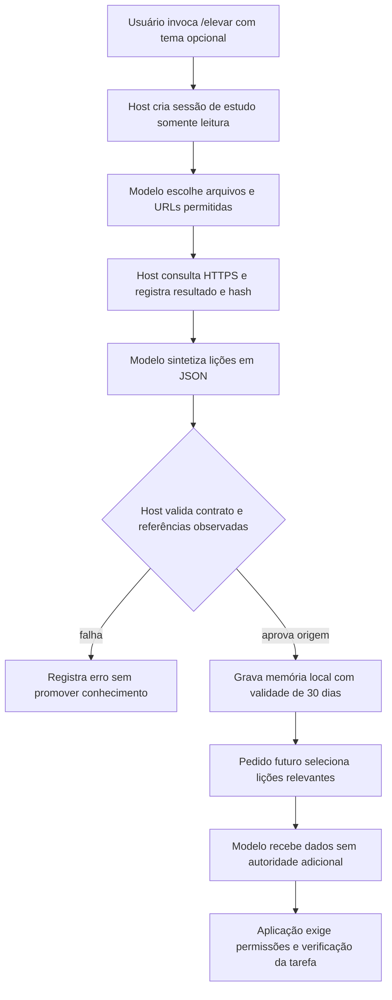

# Aprendizado persistente com `/elevar`

Implementação YZZY BLACK 0.5.0, de 21/10/2026. Este capítulo explica operação, algoritmo, contratos, controles e como implementar o mesmo mecanismo em outro projeto. As evidências de execução ficam em [VALIDACAO-0.5.0.json](replicacao/VALIDACAO-0.5.0.json).

## O significado de aprender nesta versão

O agente consegue estudar documentação online, formular procedimentos e guardá-los para usar em tarefas futuras. O conhecimento passa a existir fora da conversa que o produziu. Uma execução posterior pode recebê-lo como contexto, conferir sua adequação e aplicá-lo com as ferramentas autorizadas para aquela tarefa.

Isso implementa aprendizado por memória externa. O motor de inferência continua sendo o backend configurado, normalmente Codex. Não há treinamento automático dos pesos, criação de um novo modelo fundamental, instalação autônoma de ferramentas ou alteração do runtime durante o estudo. Um procedimento aprendido descreve uma capacidade; sua execução depende das ferramentas, permissões e ambiente disponíveis.

Essa distinção tem fundamento prático: o [Cookbook oficial sobre memória e compactação](https://developers.openai.com/cookbook/examples/agents_sdk/building_reliable_agents_memory_compaction) separa a continuidade da execução atual da reutilização de lições em execuções futuras. Nosso mecanismo usa essa separação como inspiração e implementa persistência local com APIs nativas do Node. Não depende do Agents SDK.

## Operação no CMD e no chat

```text
yzzy
/elevar
/elevar investigar bibliotecas Java com javap e testes de contrato
/aprendizados
/aprendizados <id-completo>
/esquecer <id-completo>
```

Sem tema, o estudo aborda melhoria das capacidades do agente CLI: investigação de código, memória com fontes, testes e validação. Com tema, o usuário direciona o estudo. É possível incluir uma URL oficial específica no pedido para reduzir tentativas de localizar documentação.

Os equivalentes para automação são:

```bat
yzzy elevar "Java javap e contratos de bibliotecas" --json
yzzy aprendizados --json
yzzy aprendizados <id-completo> --json
yzzy esquecer <id-completo> --json
```

`elevar` emite eventos JSONL e um `elevation_result` final com sessão, tema, aprendizados e erro quando houver. O chat apresenta títulos e resumos, mantendo o JSON técnico no modo de automação. O mini globo de processamento acompanha chamadas ao modelo e leituras, como nas demais tarefas. Ctrl+C interrompe o ciclo.

O comando humano `/elevar` concede **leitura de documentação online para esse estudo**; não é necessário iniciar com `--allow-network`. A concessão usa os hosts exatos já configurados e termina junto com o estudo. As permissões da conversa principal permanecem as mesmas. O estudo abre uma sessão separada e não troca a sessão atual do chat.

Para usar depois, faça uma pergunta ou tarefa relacionada ao conhecimento salvo, como “investigue as assinaturas Java desta biblioteca com javap”. A seleção de memória acontece automaticamente em cada turno. Novos conhecimentos podem ser usados também na conversa atual, no próximo pedido. Depois de atualizar o runtime, use `/new` para iniciar uma sessão compatível.

## Fluxo executável



`src/elevation.js` coordena o ciclo. `src/agent.js` continua controlando inferência, recursos e ferramentas. `src/learning.js` valida referências, persiste, seleciona e remove aprendizados. `src/documentation.js` faz a consulta externa. `src/memory.js` mantém a distinção entre conhecimento externo e instrução humana na compactação. A interface está em `bin/yzzy.js`.

## Pesquisa na internet: alcance real

O modelo escolhe URLs adequadas ao tema e lê páginas de documentação usando `read_documentation`. Pode consultar arquivos permitidos do projeto para entender o problema antes de estudar. A versão inicial não integra um mecanismo geral de busca: não promete indexar a internet, descobrir qualquer página ou acessar sites arbitrários. URLs lembradas pelo modelo precisam ser efetivamente consultadas; uma URL plausível não conta como fonte.

Os hosts configurados incluem documentação de OpenAI, Oracle, Spring, Maven, Gradle, JUnit, MDN, React, Docker, OpenTelemetry, OWASP e RFCs. A pessoa pode editar `documentation.allowedHosts` em `yzzy.config.json` para acrescentar um hostname exato. O modelo não pode ampliar essa lista por meio do estudo. Não há wildcard ou herança implícita para subdomínios.

A leitura mantém HTTPS, DNS com endereços públicos, conexão fixada no endereço validado, TLS para o hostname original, limites de tamanho e tempo e revalidação a cada redirecionamento. IPs privados/loopback e URLs com credenciais, query ou fragmento são recusados. Não há navegador, execução de JavaScript ou acesso autenticado a páginas privadas. HTML é convertido em texto; quando possível, uma página Markdown específica oferece conteúdo mais útil dentro do limite.

Falhas de DNS, HTTP, allowlist ou conteúdo são retornadas ao modelo como falhas. Se nenhuma fonte for lida, o controlador recusa salvar aprendizados. O modelo pode tentar outra página dentro do orçamento; não existe repetição infinita de pesquisa.

## Contrato de uma lição

O último resultado do modelo precisa conter somente um objeto JSON com `lessons`, de uma a cinco entradas. Cada entrada possui exatamente:

| Campo | Finalidade e limite |
| --- | --- |
| `title` | Nome da técnica, até 200 bytes. |
| `summary` | Quando aplicar e por quê, até 1.800 bytes. |
| `steps` | De um a oito passos descritivos, até 800 bytes cada. |
| `verification` | Como conferir a aplicação, até 1.200 bytes. Não é resultado de teste executado. |
| `limits` | Versão, contexto e incertezas, até 1.200 bytes. |
| `sources` | Uma a três referências com `url` e `quote`. |

O host verifica se a URL final apareceu em uma leitura bem-sucedida na própria sessão. Verifica também se o trecho ocorre no texto retornado por essa ferramenta, aceitando equivalência apenas de espaços e quebras de linha: palavras, caixa e pontuação precisam coincidir. A referência registra `match: "exact"` ou `"whitespace_normalized"`. O trecho deve ter pelo menos 20 caracteres e até 500 bytes. Referências inventadas, trechos inventados e campos adicionais causam rejeição do lote inteiro. Uma sessão limitada, cancelada, pendente ou com efeito incerto não promove conhecimento.

O controlador acrescenta ID próprio, tema, sessão de origem, data de criação, expiração, hash SHA-256 dos bytes originais da página, data de consulta e indicação de truncamento. O hash identifica a versão observada; não é uma assinatura do editor da página. O texto integral consultado continua no journal, sujeito ao truncamento informado pela ferramenta.

`validation: "provenance_only"` significa que o vínculo com uma fonte lida foi validado. Não prova que a conclusão decorra corretamente do trecho, que a fonte esteja certa, que versões sejam compatíveis ou que o procedimento funcione. Um trecho pode ser autêntico e a interpretação estar errada. A memória permanece dado não confiável mesmo depois dessa validação.

Não há um segundo modelo certificando as conclusões nesta versão. Antes de usar uma receita para mudar software, o agente deve conferir o contrato e executar as verificações autorizadas. O [Cookbook de melhoria de agentes](https://developers.openai.com/cookbook/examples/agents_sdk/agent_improvement_loop) fundamenta a necessidade de avaliar mudanças de comportamento com evidências. Nosso teste de integração demonstra o fluxo; não mede ganho geral de capacidade.

## Persistência e recuperação

O armazenamento por workspace fica em `.yzzy/learning.json`. Usa o lock existente do workspace, arquivo temporário exclusivo, escrita com `fsync` e substituição por rename. O diretório e o arquivo são inspecionados para recusar redirecionamento por symlink; o arquivo precisa ser regular, com um único hardlink e até 1 MiB. O conjunto tem no máximo 100 lições.

O checksum do conjunto detecta corrupção acidental. Não autentica dados contra alguém com acesso para reescrever arquivo e checksum. A redação de segredos conhecidos acontece antes do hash e da escrita. Ela é uma precaução limitada, não uma garantia de detecção de qualquer segredo. Trechos selecionados e arquivos consultados podem ser enviados ao backend de inferência configurado.

O algoritmo de recuperação é deliberadamente pequeno e inspecionável:

1. Leia e valide o armazenamento; dados inválidos não são injetados silenciosamente.
2. Selecione somente lições com validade ativa e fontes ainda compatíveis com a allowlist atual.
3. Normalize tema, título, resumo e pedido: minúsculas, remoção de acentos, tokens alfanuméricos com pelo menos três caracteres e remoção de palavras comuns. Considere até 80 tokens distintos.
4. Conte interseções entre os tokens do pedido e os tokens de cada lição. Descarte pontuação zero; ordene por pontuação e, em empate, pela criação mais recente.
5. Inclua até três lições, dentro do menor valor entre 10.000 bytes e um oitavo do limite de contexto configurado.
6. Envie as lições como mensagem de dados explicitamente não confiáveis antes do pedido atual, sem colocá-las nas instruções de sistema. Registre os IDs selecionados no estado.

Não há embeddings, banco vetorial, compreensão semântica garantida ou consulta automática à internet a cada recuperação. Uma pergunta sinônima sem termos em comum pode não recuperar uma lição útil. Uma correspondência lexical pode recuperar algo inadequado. Esses são limites conhecidos a medir antes de trocar o algoritmo.

Na retomada, a antiga mensagem de memória é substituída por uma seleção atual. Lições esquecidas ou expiradas não continuam sendo reinjetadas. Durante compactação, a mensagem de conhecimento continua marcada como externa e não vira uma entrada de `userInstructions` no resumo extrativo.

A validade inicial é de 30 dias. Expirar impede recuperação automática, mas mantém o item visível na listagem. Novo estudo pode renovar uma conclusão idêntica quando título, conteúdo e hashes das fontes coincidirem. Conclusões diferentes coexistem, sem apagamento automático por suposta superioridade. Use `/esquecer` para remover uma lição errada, substituída ou indesejada. Se o armazenamento estiver cheio, o agente informa a necessidade de remoção.

Esquecer retira o registro da memória ativa; não apaga journals anteriores, mensagens do modelo que tenham se baseado nele, cópias ou exportações. A conversa pode continuar contendo referências históricas. Para excluir esse conteúdo também, a pessoa precisa administrar esses artefatos separadamente.

## Limites e guardrails do ciclo

O estudo tem no máximo dez chamadas ao modelo, vinte tentativas de ferramentas, oito leituras externas e três minutos. Sempre prevalece um limite menor configurado pelo usuário. Reutiliza orçamento e regras de admissão existentes, inclusive precificação exigida para API paga direta. O plano/cota do Codex continua gerido pelo produto; não se promete um teto monetário artificial para esse backend.

O catálogo de estudo contém somente `list_files`, `search`, `read_file`, `read_lines` e `read_documentation`. Mesmo que o modelo invente uma chamada de escrita, shell ou execução, o controlador recusa antes do efeito. `--allow-host-shell` e permissões de escrita da conversa não são herdados. A sessão de estudo não recebe aprendizados anteriores, reduzindo a recirculação de conclusões próprias como se fossem novas evidências.

Não existe ferramenta de gravação de memória exposta ao modelo: a promoção acontece no host, depois que o ciclo termina e libera o lock. O resultado da promoção é registrado no journal em `elevation_result`. Falta de espaço, corrupção ou falha de persistência retorna erro; o JSONL final informa o estado operacional. Uma interrupção abrupta entre gravação da memória e registro do resultado pode deixar uma lição persistida sem o último evento: os dois arquivos não formam uma transação única. Consulte `/aprendizados` antes de repetir; há deduplicação de conteúdo idêntico.

Prompt injection continua sendo um risco semântico: uma página pode tentar ensinar regras maliciosas. A indicação “não confiável” orienta o modelo; os controles de ferramenta e permissões são executáveis. Este mecanismo não certifica conteúdo externo e não elimina a necessidade de avaliar a aplicação. Se a pessoa conceder shell do host em uma tarefa posterior, esse modo continua tendo os poderes amplos já documentados; a memória não o torna isolado.

## Como outro projeto implementa o mesmo mecanismo

Primeiro separe motor de inferência, controlador, ferramentas, armazenamento e interface. Não trate uma resposta do modelo como autorização de escrita ou como um fato verificado. Defina um comando humano explícito para iniciar estudo e um orçamento absoluto para a execução inteira.

Implemente leitura externa com origem observada e limites antes de implementar a memória. Use uma estrutura de retorno contendo URL final, conteúdo realmente disponibilizado ao modelo, hash, data e truncamento. A validação precisa usar esse retorno, não uma lista de referências escrita livremente pelo modelo.

Depois implemente um perfil de pesquisa com um catálogo reduzido no host. Teste tentativas de chamar ferramentas ausentes; esconder o nome de uma ferramenta no prompt é insuficiente. Não herde credenciais ou permissões de execução apenas porque outro modo do agente as possui.

Defina um schema pequeno de lição, valide tamanho e campos, confronte trechos e referências com leituras registradas e salve todos os itens de um lote de forma atômica no arquivo de memória. Registre status de proveniência separado de correção semântica. Planeje correção, remoção, expiração e limite de armazenamento desde o início.

Acrescente recuperação conservadora por tarefa. Teste ausência de relevância, alteração de allowlist, corrupção, expiração e exclusão em uma sessão retomada. Garanta que resumir o histórico não transforme conhecimento externo em instrução humana. Preserve os controles de execução usados antes de introduzir a memória.

Para avaliar melhoria, congele um conjunto de tarefas de treino e outro de avaliação por origem. Execute condições com memória desligada e ligada com os mesmos modelos, ferramentas, limites e tentativas. Meça sucesso por testes externos, uso incorreto de receitas, violações de política, tempo e custo. Inclua versões incompatíveis, fontes contraditórias e injeções. Relate resultados negativos. Uma lição salva com sucesso não prova aumento de inteligência.

Se quiser evoluir para autodesenvolvimento de código, implemente outro fluxo com alteração em branch/worktree, avaliações independentes, diff revisável e regras explícitas de ativação e rollback. Isso é uma evolução futura: `/elevar` atual guarda conhecimento e não reescreve automaticamente o próprio runtime.

## Verificações reproduzíveis

```bat
node --test tests/learning.test.js
npm.cmd test
npm.cmd run check
node scripts/elevation-smoke.js
node scripts/elevation-smoke.js --default-cli
```

Os testes unitários usam provedor e fonte injetados para exercitar o controlador sem rede ou cobrança. O smoke exige Codex autenticado e internet: lê documentação pública da Oracle, guarda uma lição e faz uma nova inferência com a memória recuperada. A opção `--default-cli` testa também `yzzy elevar` sem tema, executando o estudo padrão pelo CLI. Ambos criam fixtures temporárias; não adicionam aprendizados de teste à memória do seu projeto. Identifique sempre qual tipo de evidência foi realmente executado.
