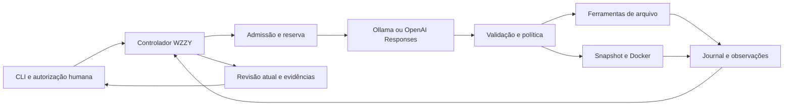

# Arquitetura e decisões

## Módulos

| Arquivo | Responsabilidade e motivo |
|---|---|
| `bin/wzzy.js` | CLI, chat, eventos JSONL, diagnóstico e cancelamento |
| `src/config.js` | Defaults, validação estrita, ambiente e fingerprint |
| `src/agent.js` | Ciclo sequencial, checkpoints, correlação, limites e conclusão |
| `src/providers.js` | Contratos HTTP específicos, sem executar propostas |
| `src/tools.js` | Schema canônico e autorização por capacidade |
| `src/workspace.js` | Caminhos, busca, hashes, edição e snapshots |
| `src/executor.js` | Docker, captura limitada e limpeza do container |
| `src/budget.js` | Reserva e liquidação usando microdólares e BigInt nos cálculos |
| `src/journal.js` | Eventos encadeados, fsync, locks e inspeção |
| `src/demo.js` | Fixture e agente roteirizado exclusivamente para demonstração/testes |
| `evaluations/` | Manifesto de desenvolvimento, cenários e relatórios |

## Um turno

1. Carregar configuração, canonicalizar workspace e obter lock exclusivo.
2. Criar sessão ou validar configuração, autoridade e estado da retomada.
3. Montar contexto com instruções persistidas, schema e transcript completo.
4. Conferir limites e reservar o custo antes de enviar a requisição.
5. Aguardar resposta íntegra; validar IDs, formato e argumentos.
6. Registrar decisão de política, checkpoint de início e resultado de cada ferramenta.
7. Retornar observações ao modelo. Em pergunta, suspender para resposta humana.
8. Quando o modelo encerra, comparar a revisão atual às evidências reais e registrar o status do controlador.

Chamadas são sequenciais mesmo se um provedor emitir um lote. IDs correlacionam cada resultado à proposta. Um lote com `ask_user` e outras ferramentas é rejeitado antes de executar efeitos. Não há retries automáticos: uma falha de rede pode ter custo desconhecido. A retomada explícita permite nova tentativa mantendo as reservas e limites anteriores.

## Estados finais

| Estado | Significado |
|---|---|
| `completed_unverified` | Modelo encerrou; não há todas as verificações atuais necessárias |
| `checks_passed` | Todos os comandos marcados `verification` têm última execução aprovada na revisão atual |
| `verified` | Avaliador independente da fixture offline aprovou seus critérios específicos |
| `failed` | Verificação atual ou avaliador independente reprovou |
| `waiting_user` | Pergunta registrada; aguarda orientação via `resume` |
| `limited` | Teto de chamadas, contexto, custo, tempo ou repetição atingido |
| `blocked_uncertain` | Execução teve efeito/limpeza incerto; revisão manual e nova sessão necessárias |
| `cancelled` / `error` | Interrupção humana ou falha de infraestrutura/contrato |

Um código de saída 0 também pode corresponder a `completed_unverified`: ele indica término operacional, não correção científica. Automações devem ler o status JSON. O controlador não transforma uma alegação textual de sucesso em `verified`.

## Contexto e persistência

`WZZY.md` da raiz é carregado como orientação de projeto e congelado na sessão. Não há descoberta recursiva de `AGENTS.md`, LSP, embeddings, índice vetorial, skills executáveis ou resumo automático. `read_lines` e busca literal permitem selecionar conteúdo. Ao exceder o teto em bytes, o runtime para preservando o histórico. A aplicação não promete estimativa exata da janela em tokens de cada modelo.

Cada evento contém sequência, hash do anterior, timestamp, dados e checkpoint. SHA-256 encadeado detecta alteração acidental/inconsistência, sem oferecer autenticidade contra quem pode reescrever todos os arquivos. O journal persiste o transcript necessário à retomada; OpenAI conserva os itens nativos, incluindo conteúdo opaco necessário à continuidade de modelos de raciocínio. O programa não solicita nem mostra cadeia de pensamento privada; Ollama usa `think:false`.

Na retomada, configuração, hash dos módulos do runtime e flags devem coincidir. Orçamento e prazo absoluto não reiniciam. Ferramenta iniciada sem resultado, ou lote com resultados ausentes, bloqueia replay. O operador inspeciona a situação e abre nova sessão. Um pedido de modelo interrompido pode deixar reserva retida; nova tentativa explícita não apaga esse gasto potencial.

## Edição e evidência

`replace_text` exige hash dos bytes lidos e uma ocorrência exata, cria arquivo temporário, sincroniza e revalida o hash antes de renomear. Isso detecta os conflitos cobertos pelos testes; não implementa compare-and-swap atômico do filesystem contra um processo host malicioso. A criação usa `wx` para impedir sobrescrita. Não há ferramenta de remoção.

O executor copia arquivos permitidos para diretório temporário, calcula manifesto de conteúdo e monta essa cópia como somente leitura. O comando não modifica o checkout. Ao terminar, a revisão é recalculada: mudança humana invalida a evidência. Um resultado aprovado exige exit code 0, saída não truncada, ausência de timeout/cancelamento, revisão atual correspondente e remoção conhecida do container. Alterações posteriores invalidam evidências antigas.

Testes do próprio projeto podem ter cobertura insuficiente ou ser alterados pelo agente quando `tests` integra o escopo. Por isso `checks_passed` tem significado limitado. Uma avaliação de produto requer um grader controlado fora do escopo do agente, como o smoke real de uma tarefa.
