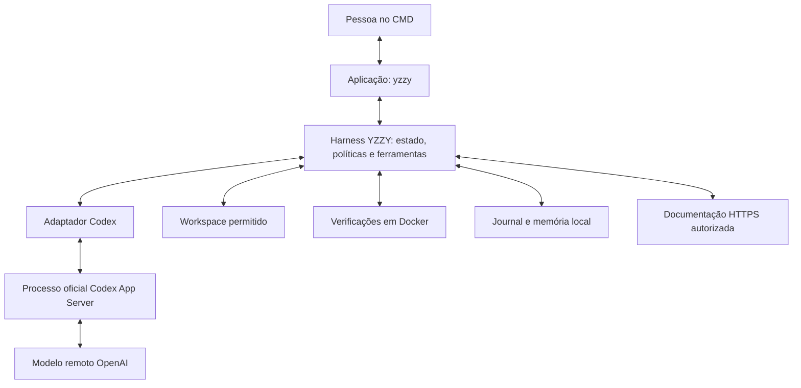

# 1. Modelo, harness e o que estamos reproduzindo

Data do estudo: **21/10/2026**. Implementação documentada: YZZY BLACK **0.3.0**, estendendo o núcleo 0.2.3, com `@openai/codex` fixado em **0.163.0**. Esta série é um estudo técnico original das superfícies públicas e da nossa implementação. O registro bibliográfico e o método de atualização estão em [FONTES.md](FONTES.md).

## 1.1 O significado de “extração do Codex” neste repositório

Aqui, extração significa identificar componentes públicos, contratos de integração e práticas de engenharia que podemos implementar e testar. O estudo inclui um recorte de 15 arquivos públicos versionados, registrado em [UPSTREAM.json](UPSTREAM.json), e sua análise em [08-EXTRACAO-DO-CODIGO-PUBLICO.md](08-EXTRACAO-DO-CODIGO-PUBLICO.md). Não significa obter pesos fechados, dados privados de treinamento, prompts internos de produção ou uma cópia completa do produto OpenAI. Tampouco podemos observar todos os mecanismos privados do serviço a partir de uma resposta do terminal.

Usamos quatro categorias de evidência nesta documentação:

| Categoria | O que permite afirmar | Exemplo |
| --- | --- | --- |
| Público documentado | Uma fonte primária descreve uma capacidade | O App Server possui threads, turnos e eventos. |
| Implementado localmente | Há código executável no nosso repositório | O controlador valida ferramentas antes de editar. |
| Decisão de engenharia | Escolhemos um comportamento, com justificativa e critérios | Separar investigação de uma revisão crítica. |
| Fora do escopo ou não implementado | Faltam acesso, código ou validação | Treinamento de pesos próprios equivalentes aos modelos fechados. |

Essas categorias impedem que uma boa instrução em Markdown seja apresentada como isolamento de segurança, ou que um perfil “Java” seja chamado de novo modelo treinado.

## 1.2 Cinco componentes diferentes

Um **modelo** transforma entradas em saídas com parâmetros aprendidos. Um **servidor de inferência** carrega esses parâmetros, administra processamento e atende solicitações. Um **harness** mantém o ciclo entre modelo e ferramentas. Uma **aplicação** oferece interface, identidade e fluxos do usuário. Um **ambiente de execução** fornece arquivos, processos e recursos para executar ações.

O material oficial define o harness como o sistema ao redor do modelo que administra trabalho, contexto e interação com ferramentas. Ele distingue essa camada aberta do acesso aos modelos e aos serviços gerenciados. [Codex as a platform](https://developers.openai.com/blog/codex-as-a-platform).

No nosso caso:



O componente `src/agent.js` é nosso controlador principal. `src/codex-provider.js` adapta o contrato de inferência. `src/codex-rpc.js` administra o processo oficial. `src/workspace.js` opera arquivos. `src/executor.js` executa verificações cadastradas. `src/journal.js` registra o andamento. Na extensão 0.3.0, `src/team.js` coordena consultas especializadas sequenciais e `src/documentation.js` lê documentação externa autorizada. A interface do terminal não é o modelo; ela apresenta as entradas, respostas e eventos produzidos por essas camadas.

## 1.3 Como um modelo de linguagem funciona: visão conceitual

**Conceito público e geral, não descrição dos detalhes secretos de um GPT específico.** Texto é representado por unidades chamadas tokens. Um token pode representar uma palavra, parte dela ou caracteres; bytes, palavras e tokens são medidas diferentes. O nome GPT remete à família de transformadores generativos pré-treinados. A documentação descreve esses modelos como capazes de trabalhar com linguagem natural e formal. [Key concepts](https://developers.openai.com/api/docs/concepts).

Um modelo autoregressivo pode ser representado, de forma didática, pela distribuição:

```text
P(saída | contexto) = produto de P(token_t | contexto, tokens anteriores)
```

O contexto contém instruções, a solicitação e as informações que o aplicativo forneceu. Os parâmetros influenciam as probabilidades. O processo de inferência produz os próximos tokens até uma condição de parada. Essa explicação ajuda a entender por que faltas de contexto, ambiguidades e mudanças de modelo podem alterar o resultado; ela não revela quantidade de camadas, arquitetura interna exata ou corpus de nenhum modelo fechado.

Em uma arquitetura Transformer, mecanismos de atenção relacionam representações das posições do contexto, enquanto outras transformações produzem representações úteis para a previsão. É uma explicação conceitual da família, não uma especificação reproduzível do modelo remoto utilizado pelo Codex.

### Pré-treinamento, pós-treinamento e inferência

No pré-treinamento, parâmetros são ajustados a partir de grandes conjuntos de exemplos para aprender regularidades. A composição e a receita exatas dos modelos fechados usados pela conta não estão disponíveis neste repositório. Pós-treinamento é uma família de etapas posteriores que orientam comportamento e qualidade. Inferência usa um modelo já preparado para responder; não é automaticamente uma nova rodada de treinamento.

Como exemplo público de personalização, o ajuste supervisionado utiliza pares de entradas e respostas desejadas para alterar comportamento. Não é o mesmo que anexar arquivos ao contexto. Na consulta desta data, a própria documentação informa encerramento gradual da plataforma de fine-tuning e ausência de acesso para novos usuários; portanto, não tratamos essa oferta como caminho garantido de implementação. [Supervised fine-tuning](https://developers.openai.com/api/docs/guides/supervised-fine-tuning).

Outro exemplo público é o ajuste por reforço: respostas candidatas recebem uma avaliação, e a otimização torna saídas bem avaliadas mais prováveis. Isso exige uma função de avaliação confiável; “ter vários especialistas conversando” não implementa esse treinamento. A disponibilidade dessa oferta também precisa ser verificada antes de qualquer projeto. [Reinforcement fine-tuning](https://developers.openai.com/api/docs/guides/reinforcement-fine-tuning).

### O que chamamos de pensar

Modelos de raciocínio podem utilizar tokens internos de raciocínio, que consomem contexto e recursos. Esses tokens não constituem uma prova de execução de ferramentas nem um relatório público de todas as operações internas. A integração atual não extrai essa sequência privada. [Reasoning models](https://developers.openai.com/api/docs/guides/reasoning).

Nosso globo indica uma operação pendente do controlador. A palavra “Pensando” é um estado da interface durante uma chamada; não é uma leitura do pensamento do modelo, um percentual de conclusão ou garantia de acerto.

## 1.4 O que faz o agente programar e depurar

Um modelo pode conhecer sintaxe Java e sugerir correções, mas conhecer sintaxe não informa qual versão de uma biblioteca está no checkout, qual teste falha ou qual comportamento o usuário contratou. O harness conecta a hipótese a observações reais.

No YZZY, uma investigação pode seguir este ciclo:

1. Identificar a tarefa e a evidência necessária.
2. Ler arquivos permitidos e localizar os símbolos relevantes.
3. Construir uma hipótese que explique a falha observada.
4. Propor uma ação no catálogo de ferramentas.
5. Validar permissão, caminho, argumentos e orçamento.
6. Executar a ação e registrar o resultado real.
7. Corrigir a hipótese se o resultado a contradisser.
8. Verificar a revisão final e explicar limites do que foi comprovado.

Essa sequência é nosso processo de engenharia, descrito a partir do controlador. Não afirmamos que ela reproduz cada decisão interna do produto Codex. Um erro útil retorna como dado ao ciclo; ele não autoriza relaxar a política nem inventar sucesso.

Para Java, “entender a biblioteca” exige vincular artefato, versão, configuração, chamadas e comportamento observado. Inspecionar um método isolado pode deixar de fora interceptadores, geração de código, class loaders, concorrência e efeitos de persistência. Os especialistas devem organizar essa investigação; nenhuma especialidade elimina a necessidade de evidências do ambiente real.

## 1.5 Por que não transferimos todas as ações ao Codex

**Decisão local implementada:** usamos o Codex como gerador de propostas estruturadas. As ferramentas nativas dele são desativadas nesse caminho; as ações reais passam pelas ferramentas YZZY. Isso mantém a mesma política para os adaptadores Codex, OpenAI direto e Ollama.

O modelo pode sugerir `replace_text`, mas o controlador exige autorização humana de escrita, raiz permitida e hash da leitura. A segurança operacional dessa ferramenta decorre do código validador, e não de o modelo ter prometido obedecer. O protocolo detalhado está em [02-PROTOCOLO-E-CONTEXTO.md](02-PROTOCOLO-E-CONTEXTO.md).

O preço dessa opção é ter uma integração mais restrita do que o Codex completo: capacidades nativas como pesquisa web, MCPs e múltiplos agentes do processo de inferência não são automaticamente disponibilizadas. A versão 0.3.0 implementa dois caminhos próprios: consultas sequenciais de especialistas com orçamento agregado e leitura HTTPS por `read_documentation`, com `--allow-network` e domínios exatos permitidos. São extensões do host YZZY, sem reativar ferramentas nativas do Codex. Veja [a equipe](04-EQUIPE-E-ORQUESTRACAO.md) e [pesquisa e validação](07-PESQUISA-E-VALIDACAO.md).

## 1.6 Três caminhos de independência

| Caminho | O que controlamos | O que continua externo |
| --- | --- | --- |
| Codex atual | Produto, perfis, histórico, políticas e ferramentas YZZY | Executável oficial, autenticação, disponibilidade e modelo remoto. |
| API de modelo | Toda a integração e o ciclo no nosso processo | Serviço de inferência, conta e custos do provedor. |
| Modelo aberto servido localmente | Também infraestrutura e arquivos de pesos conforme licença | Origem dos pesos, qualidade do modelo base, hardware e manutenção. |

O projeto já tem um adaptador Ollama; isso não significa que um modelo compatível foi baixado ou validado neste trabalho. Como alternativa pública de estudo, `gpt-oss-20b` possui pesos abertos e capacidade de personalização segundo a documentação oficial. É um modelo diferente, sem promessa de equivalência ao modelo fechado do Codex. [Modelo gpt-oss-20b](https://developers.openai.com/api/docs/models/gpt-oss-20b).

A execução com Transformers é documentada, mas requer dimensionar memória, formato e ambiente. Ter um adaptador não comprova que o hardware do usuário consegue servir o modelo escolhido. [Execução de gpt-oss com Transformers](https://developers.openai.com/cookbook/articles/gpt-oss/run-transformers).

## 1.7 Como avaliar uma reprodução honesta

**Decisão de engenharia:** reproduzimos comportamentos observáveis com cenários e critérios, em vez de afirmar identidade interna. Uma tarefa de depuração mede localização da causa e regressões. Uma tarefa de segurança mede rejeição de caminhos proibidos. Uma tarefa de conversa mede preservação de requisitos depois da compactação. Uma tarefa de equipe mede qualidade e integração dos pareceres, além de custo.

O protocolo, o prompt, o modelo e o ambiente são variáveis separadas. Melhorar um prompt sem medir pode ocultar uma regressão. O material oficial recomenda ciclos de avaliação e ajustes porque as saídas são não determinísticas e variam entre modelos. [Model optimization](https://developers.openai.com/api/docs/guides/model-optimization).

Não há nesta entrega treinamento do zero, extração de pesos fechados, equivalência comprovada de benchmarks ao Codex nem reprodução dos seus mecanismos privados de segurança. Há uma implementação própria que podemos ler, modificar e testar, utilizando uma integração pública de inferência.
