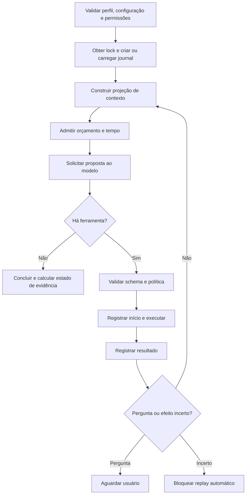

# 2. Protocolo, ciclo de execução e memória

Estudo de **21/10/2026**, atualizado para YZZY BLACK **0.3.0**, a partir do núcleo 0.2.3 e com pacote oficial Codex **0.163.0**. Documentação online pode descrever versões posteriores; o contrato efetivamente utilizado é o que nosso adaptador e nossos testes aceitam. Referências: [FONTES.md](FONTES.md) e [estudo versionado do código público](08-EXTRACAO-DO-CODIGO-PUBLICO.md).

## 2.1 Contrato público e contrato do YZZY

O App Server diferencia conversa (`thread`), trabalho iniciado por uma entrada (`turn`) e unidades de entrada, saída ou ação (`item`). Seu ciclo documentado inicializa uma conexão, cria ou retoma uma thread e inicia um turno. Esse é o protocolo público que embasa nossa ponte. [Codex App Server](https://learn.chatgpt.com/docs/app-server).

O contrato interno do YZZY é menor. O controlador chama:

```js
generate({ system, messages, tools, signal })
```

E recebe conceitualmente:

```js
{
  text: 'mensagem ao usuário',
  calls: [{ id: 'correlação', name: 'read_file', args: { path: 'src/Exemplo.java' } }],
  resolvedModel: 'modelo informado pelo provedor',
  billing: 'managed_by_codex',
  usage: { input: 0, output: 0 }
}
```

Os números acima são ilustrativos; não representam consumo de uma chamada real. A presença de um campo de uso não prova custo zero. Em caso de metadados insuficientes, o uso pode ser `null`.

## 2.2 Sequência exata da ponte atual

Esta seção descreve **nosso código**, principalmente `src/codex-rpc.js` e `src/codex-provider.js`.

1. `codexExecutable()` seleciona o binário nativo do pacote de plataforma instalado. No Windows, o alvo inclui `codex.exe`. O caminho pode ser substituído por uma variável de ambiente confiada pelo operador; isso amplia a base de confiança e não é uma opção concedida ao modelo.
2. O adaptador cria um diretório temporário vazio com prefixo `yzzy-inference-`. O checkout do usuário não é o diretório de trabalho do processo de inferência.
3. Inicia o executável com `app-server --listen stdio://`. `spawn` usa argumentos separados, `shell: false` e janela oculta no Windows.
4. Envia `initialize` com a identidade do cliente e depois a notificação `initialized`.
5. Consulta `account/read` para verificar uma conta autenticada. Não extrai a credencial para incluí-la nas mensagens do modelo.
6. Consulta a configuração efetiva e desativa os MCPs encontrados para esse processo. Nomes de MCP inesperados provocam erro em vez de formar chaves de configuração arbitrárias.
7. Envia `thread/start` com thread efêmera, diretório temporário, sandbox nativo de leitura e aprovação `never`. Se `config.model` estiver vazio, transmite `null` para a resolução padrão do Codex.
8. Registra o observador de eventos antes de iniciar o turno. Essa ordem evita perder um evento emitido antes da resposta a `turn/start`.
9. Envia `turn/start` contendo o histórico e catálogo serializados, além de `outputSchema`.
10. Acumula a saída, acompanha uso e rejeita eventos de ferramentas nativas inesperadas. Só interpreta a proposta após a conclusão bem-sucedida.
11. Decodifica o JSON e converte as chamadas propostas para nosso contrato. Cada correlação é gerada no host.
12. Fecha a conexão e o processo em `finally`, mesmo em erro ou cancelamento.

O adaptador não mantém uma thread nativa persistente entre essas chamadas. A continuidade vem do nosso histórico, reapresentado na chamada seguinte. Isso simplifica separação e retomada, mas pode aumentar latência e tokens. Uma mudança para threads persistentes precisa comprovar que histórico e permissões continuam coerentes; não basta guardar um `threadId`.

## 2.3 Transporte por linhas e correlação

O transporte atual utiliza objetos JSON separados por nova linha na entrada e saída padrão. `src/codex-rpc.js` mantém um mapa de solicitações pendentes por `id`, contador de correlação e temporizador por solicitação. Respostas resolvem a promessa associada; notificações vão para observadores.

Uma leitura do pipe pode conter apenas parte de uma mensagem ou várias mensagens. O buffer só interpreta linhas completas. Há limite de 4 MiB no buffer e retenção limitada da saída de erro do processo. JSON inválido, encerramento do filho ou falha do pipe propagam erro às operações pendentes.

Pedidos nativos de aprovação são recusados. Outras solicitações nativas que exigiriam uma implementação de ferramenta do cliente recebem erro de método. Essa é uma defesa adicional à desativação de recursos. O processo Codex e suas dependências continuam sendo componentes confiados: o filtro de eventos não constitui uma barreira absoluta do sistema operacional.

## 2.4 Por que a resposta é uma proposta

O schema de saída do adaptador Codex exige `text` e `calls`, sem propriedades extras, e aceita no máximo **uma ferramenta por resposta**. O nome é restrito ao catálogo e `arguments` é um objeto serializado como texto JSON. O host interpreta esse texto e aplica uma segunda validação dos argumentos de cada ferramenta.

Exemplo didático, sem efeito até validação e execução pelo host:

```json
{
  "text": "Vou ler a implementação para localizar a origem da falha.",
  "calls": [
    {
      "name": "read_file",
      "arguments": "{\"path\":\"src/Servico.java\"}"
    }
  ]
}
```

O JSON não executa um comando por si. Não existe interpretação de `arguments` como código JavaScript ou shell. O validador aceita somente chaves e tipos definidos em `src/tools.js`. O controlador suporta um limite próprio de lote para os outros adaptadores; o limite mais estreito do Codex prevalece nesse caminho.

Saída estruturada ajuda a reduzir a ambiguidade entre “o modelo disse para ler” e “a ferramenta foi chamada”. Ela não torna o conteúdo semanticamente correto, nem substitui a validação de caminhos ou permissão.

## 2.5 O ciclo do controlador

`src/agent.js` mantém uma máquina de estados com registros antes e depois de operações. O fluxo simplificado é:



O controlador registra a proposta e seu resultado com correlação. Resposta textual não serve como registro de execução. A frase “rodei os testes” não gera evidência, porque apenas o caminho real de `run_check` produz esse registro.

## 2.6 Instruções, persona e orientação do projeto

O sistema local é composto por regras fixas do controlador, instruções do perfil, preferências, concessões efetivas e orientação `YZZY.md`, com fallback legado para `WZZY.md`. O código informa explicitamente que a orientação de projeto é subordinada ao controlador.

`src/profiles.js` transforma preferências em instruções: idioma, tom, detalhamento e política de perguntas. `essential` pede esclarecimento quando a informação realmente muda a solução; `always` privilegia alinhamento antes de mudanças relevantes; `assume` permite suposições explícitas em decisões reversíveis já autorizadas. Nenhuma preferência concede acesso adicional.

Perfis `readOnly` reduzem as concessões efetivas de escrita e execução mesmo quando a linha de comando pediu permissões maiores. Na equipe, essa restrição do perfil humano selecionado é aplicada antes da coordenação e preservada no relatório. Todas as consultas especializadas têm escrita e execução desabilitadas, enquanto a consulta externa continua dependendo de sua concessão separada. As instruções do especialista afetam sua abordagem; o bloqueio de capacidades é responsabilidade do host.

Uma particularidade auditável: `YZZY.md` é incorporado à string de instruções de desenvolvedor. Embora esteja rotulado como orientação subordinada e protegido contra escrita pelas ferramentas, ele deve ser mantido por um operador confiável. O rótulo textual não elimina influência sobre o modelo; permissões continuam sendo verificadas fora dele.

## 2.7 Histórico completo e contexto não são a mesma coisa

O journal em `.yzzy/sessions/<id>.jsonl` preserva eventos locais e estado. O contexto enviado ao modelo é uma projeção desse material. O modelo não consulta automaticamente todo o arquivo de histórico, e um resumo não significa que todos os detalhes antigos estejam disponíveis na inferência atual.

O resumo de `src/memory.js` é **extrativo**: coleta objetivo, instruções humanas, agente, permissões, arquivos alterados com hashes, referências de evidências, erros recentes, respostas recentes, pendências e recursos consumidos. Não usa embeddings, treinamento de pesos nem uma chamada oculta para produzir uma interpretação semântica.

A compactação automática é considerada quando existem pelo menos oito mensagens e o tamanho ultrapassa 70% do limite de contexto em bytes. Ela preserva blocos recentes para manter uma proposta junto de seus resultados e acrescenta memória operacional. `/compact` solicita a projeção forçada quando aplicável. O histórico original não é apagado.

Há limites reais: manter todas as instruções humanas pode tornar a própria projeção grande; as respostas antigas são resumidas ou omitidas; um hash registra uma revisão, mas não substitui seu conteúdo. Por isso o agente deve reler o arquivo antes de editar. O orçamento rejeita contexto excessivo mesmo após a projeção.

## 2.8 Retomada, integridade e efeitos incertos

O journal encadeia hashes dos eventos e valida sequência, predecessor e conteúdo ao carregar. Isso detecta corrupção ou alteração inconsistente. Não é uma assinatura digital: alguém com acesso de escrita ao histórico pode recomputar toda a cadeia. As permissões locais do sistema operacional continuam relevantes.

Uma retomada exige mesmo workspace, impressão da configuração, versão lógica do runtime, identidade da persona e permissões. Não há aumento de permissões no meio da sessão por uma mensagem do modelo. Uma mudança desses elementos exige nova sessão.

Se uma ferramenta ficou pendente, há resultado não correlacionado ou pode ter ocorrido efeito sem confirmação, o controlador recusa repetir automaticamente. Repetir uma leitura é diferente de repetir uma criação cujo resultado foi perdido. Essa separação protege contra duplicações e conclusões indevidas após crash.

O prazo total usa a criação original da sessão; retomá-la não reinicia os recursos. Uma chamada de modelo interrompida pode manter uso desconhecido registrado, em vez de fingir que não existiu consumo.

Na extensão 0.3.0, sessões associadas a uma equipe têm **retomada isolada explicitamente bloqueada**: o orçamento pertence ao conjunto, e continuar uma sessão filha separada perderia essa relação. Quando uma consulta pede informação, o operador inspeciona o relatório com `yzzy team inspect <id>` e inicia nova equipe com objetivo e resposta humana completos. Não há retomada automática de todo o ledger da equipe. [Fluxo e comandos da equipe](04-EQUIPE-E-ORQUESTRACAO.md).

## 2.9 Identidade do modelo e autenticação

`model: ""` na configuração não identifica uma família fixa: deixa o Codex resolver o padrão. O adaptador registra `resolvedModel` quando disponível. Fixar a versão do executável não fixa automaticamente a versão do modelo remoto. Para comparar experimentos, registre ambos.

O ambiente do processo preserva `CODEX_HOME` e os diretórios oficiais do usuário, reutilizando a autenticação do Codex. A documentação diferencia login de produto e autenticação por API; acesso e limites variam por conta e modalidade. Nosso journal não é um gerenciador de tokens de autenticação. [Authentication](https://learn.chatgpt.com/docs/auth).

Nesse provedor, `billing: managed_by_codex` significa que o serviço oficial administra consumo. O campo local `spent` não implementa teto monetário do Codex. O cálculo de reserva monetária em `src/budget.js` é específico do adaptador OpenAI direto com preços configurados.

## 2.10 O que deve ser validado antes de evoluir a ponte

**Decisão de engenharia:** mudanças de integração precisam validar inicialização, conta ausente, timeout, cancelamento, JSON inválido, excesso de saída, evento nativo inesperado, correlação de ferramenta, retomada e sucesso sem ferramentas. A documentação online é referência de direção; o binário fixado e os testes de integração determinam a compatibilidade real.

Não habilite MCPs ou shell nativo simplesmente para resolver uma limitação de um especialista. Isso desviaria ações do caminho de política que este protocolo documenta. Primeiro defina uma capacidade do host, entradas, saídas, autorização e efeitos; depois implemente e verifique a extensão.

## 2.11 Extensão de pesquisa e coordenação na versão 0.3.0

`read_documentation` é a nona ferramenta do catálogo. A proposta contém uma URL; a política exige `allowNetwork`, e o executor valida HTTPS, domínio autorizado e endereços de rede antes da conexão. O resultado contém URL final, data de consulta, hash dos bytes recebidos, texto limitado e indicação de conteúdo não confiável. Esse resultado entra no mesmo histórico e ciclo de inferência que as ferramentas locais. Não é navegador, buscador ou download genérico de artefatos. [Pesquisa e validação](07-PESQUISA-E-VALIDACAO.md).

`runTeam` cria sessões separadas de consulta e uma sessão final de coordenação. O roteamento automático usa palavras-chave, e `--specialists` permite escolha explícita. O relatório em `.yzzy/teams/<id>.json` relaciona plano, sessões, pareceres limitados e totais. Chamadas, ferramentas, custo contabilizável e prazo são descontados antes de iniciar a próxima etapa; cada etapa não ganha um orçamento global novo.

Pareceres chegam ao coordenador como dados identificados, sem autoridade de aprovação. O coordenador deve reler o projeto antes de executar alterações, porque o estado pode ter mudado entre as consultas. A execução é sequencial; não há concorrência distribuída, isolamento de checkout por especialista ou delegação recursiva implícita. Os limites completos e critérios de parada estão em [04-EQUIPE-E-ORQUESTRACAO.md](04-EQUIPE-E-ORQUESTRACAO.md).
