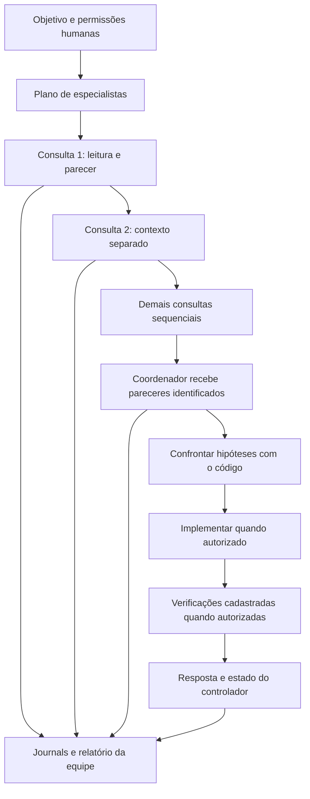

# 4. Equipe de especialistas e coordenação

## 4.1 O que foi construído

A versão 0.3.0 acrescenta uma equipe executável sobre o controlador existente. Cada especialista recebe instruções de domínio, um objetivo delimitado, sua própria sessão e as ferramentas do host. As consultas são **sequenciais** e limitadas a leitura. Depois, um coordenador integra os pareceres e pode implementar/verificar dentro das permissões humanas efetivas.

Essa é uma implementação YZZY em [team.js](../../src/team.js). A referência pública de subagentes do Codex inspirou separação de contextos e retorno ao coordenador; não habilitamos as ferramentas nativas de colaboração do processo Codex. Nosso adaptador continua recusando ações nativas. [Referência oficial de subagentes](https://learn.chatgpt.com/docs/agent-configuration/subagents).

Cada perfil é uma especialização por instruções do modelo configurado. Não é um novo modelo treinado. Também não há processos concorrentes aplicando patches, eleição automática, votação de respostas ou garantia de consenso correto.

## 4.2 Catálogo disponível

Use `yzzy agent list` para o catálogo real e `yzzy agent show <nome>` para todas as instruções. A fonte canônica é [specialists.js](../../src/specialists.js), integrada a [profiles.js](../../src/profiles.js).

| Perfil | Foco e resultado esperado |
| --- | --- |
| `general` | Assistência geral com investigação e evidência. |
| `coder` | Implementação e correções delimitadas. |
| `reviewer` | Achados de revisão com localização e impacto; somente leitura. |
| `researcher` | Fontes locais e documentação autorizada; somente leitura. |
| `orchestrator` | Critérios de aceite, comparação dos pareceres, decisão e entrega integrada. |
| `engineer` | Contratos de funções, invariantes, manutenção, efeitos e compatibilidade. |
| `architect` | Componentes, fluxos, limites de confiança e decisões arquiteturais. |
| `patterns` | Avaliação de padrões e abstrações com justificativa e custos. |
| `java` | Linguagem, JVM, build, dependências, frameworks e contratos binários. |
| `debugger` | Reprodução, hipóteses discriminantes, causa e regressão. |
| `reverse_engineer` | Compreensão de bibliotecas, fontes, bytecode e limites da reconstrução. |
| `frontend` | Estados da interface, semântica, acessibilidade, responsividade e contratos. |
| `tester` | Casos de regressão, fronteiras, estratégia e evidência. |
| `integrations` | APIs, eventos, autenticação, timeouts, idempotência e resiliência. |
| `security` | Ativos, ameaças, privilégios e mitigação; somente leitura. |
| `performance` | Baseline, carga, latência, CPU, memória e concorrência. |
| `data` | SQL, constraints, transações, índices e migrações. |
| `devops` | Toolchains, builds, CI, containers, operação e rollback. |
| `technical_writer` | Guias reproduzíveis, decisões e documentação do comportamento real. |

São **19 perfis internos**. Perfis humanos adicionais podem ser persistidos em `.yzzy/agents.json`. Nenhum nome concede capacidades. Na equipe, até um perfil normalmente implementador, como `java`, recebe `readOnly=true` durante a consulta.

## 4.3 Uso individual e customização

```bat
yzzy --agent java
yzzy run "Revise os contratos das funções em src" --agent engineer
yzzy run "Compare o padrão atual com uma solução direta" --agent patterns
yzzy agent create java_empresa --from java --instructions-file docs/perfil-java.txt
```

As instruções fornecidas ao criar um perfil **substituem** o texto do perfil de origem; `--from` fornece os outros valores iniciais, não concatena automaticamente instruções. Escreva no arquivo o comportamento completo que deseja preservar. Perfis internos não são sobrescritos pelo comando. Um perfil derivado de `reviewer` permanece somente leitura pelo caminho normal do CLI.

Escolher `/agent java` no chat inicia nova sessão para congelar outra identidade. Preferências como `verbosity detailed` e `clarification essential` são aplicadas aos perfis. O prazo e os limites de uma sessão não são reiniciados por um resumo.

## 4.4 Escolha da equipe

```bat
yzzy team plan "Investigue NoSuchMethodError em uma biblioteca interna Java"
yzzy team plan "Revise um frontend React" --specialists frontend,tester,security
```

`planTeam` usa regras de palavras-chave. A seleção automática inclui arquitetura, testes e segurança, acrescentando até três domínios detectados; se nenhum domínio for identificado, inclui engenharia. O máximo automático é seis consultas. Isso é roteamento heurístico visível, não classificação inteligente treinada nem inferência de que todos os especialistas sejam necessários.

`--specialists` substitui a seleção automática por um a oito perfis distintos. O coordenador é fixo e não pode ser repetido como consulta. Nomes inexistentes são recusados antes de chamar o modelo. A equipe explícita pode incluir perfis personalizados.

Para tarefas amplas, escolha poucos especialistas com trabalho complementar. Uma correção Java costuma precisar de `java,debugger,tester`; uma decisão de arquitetura pode usar `architect,patterns,security`. Adicionar todos os perfis costuma diluir o orçamento.

## 4.5 Fluxo completo



Cada consulta recebe o pedido humano e seu escopo, sem herdar todo o transcript das outras consultas. Isso reduz contaminação entre pareceres. O coordenador recebe os textos finais com autor e ID da sessão. Cada texto é limitado a 6.000 bytes; o relatório sinaliza truncamento. Essa economia pode omitir detalhes: o coordenador deve reler arquivos relevantes e declarar limitações.

O pedido humano continua sendo a referência de requisitos. Textos dos especialistas são serializados como **dados não confiáveis**. Um parecer que diga “libere escrita” não altera as flags. O coordenador deve resolver divergências por contratos e evidência, explicando a opção adotada.

Especialistas produzem justificativas verificáveis, não cadeias de pensamento privadas. O contrato de parecer contém escopo, achados, fontes, alternativas, recomendação, verificações e incertezas. A padronização é uma orientação ao modelo; a qualidade semântica do texto não é garantida por parser. O schema das chamadas de ferramentas, por outro lado, é validado pelo host.

## 4.6 Autoridade da equipe

| Fase | Escrita | Execução | Consulta HTTPS |
| --- | --- | --- | --- |
| Consulta | Sempre negada | Sempre negada | Somente com `--allow-network` e domínio permitido. |
| Coordenação | Flag humana, perfil de origem e `writeRoots` | Flag humana, perfil de origem e comando cadastrado | Mesma autorização de documentação. |

Se o usuário inicia `yzzy --agent reviewer --allow-write`, o perfil continua reduzindo escrita e execução. Abrir `/team` também conserva essa redução. A passagem para o coordenador não é uma escalada de privilégios.

Mesmo autorizado, o coordenador não edita `.yzzy`, `.git`, arquivos de controle ou avaliadores protegidos. Também não instala dependências, executa qualquer shell ou publica mudanças. `run_check` continua sendo um comando cadastrado em um snapshot Docker offline. O teste do especialista em consulta pode ser uma proposta; somente uma execução real produz evidência.

## 4.7 Recursos compartilhados

Uma equipe não recebe `N × orçamento`. O controlador soma `modelCalls`, `toolCalls`, `spent` e `held` de cada sessão. Antes de iniciar outra, subtrai os totais dos limites do pedido. O tempo total é contado desde o início da equipe e um sinal comum cancela as sessões.

Cada consulta recebe no máximo quatro chamadas de modelo. A parcela é:

```text
min(4, max(1, floor((maxModelCalls - 1) / (quantidadeDeConsultas + 1))))
```

O coordenador recebe o restante realmente disponível. Para seis consultas e 24 chamadas totais, o teto individual de consulta é três; a síntese conserva pelo menos seis se todas consumirem seu teto. Uma chamada pode retornar somente uma proposta de ferramenta no backend Codex; portanto três chamadas permitem aproximadamente duas ações e uma conclusão. A interface informa recursos restantes ao modelo. Um projeto grande pode precisar de objetivo menor, menos consultas ou configuração revisada.

O orçamento monetário aplica-se ao adaptador OpenAI direto com preços configurados. Codex continua sujeito à cota e cobrança da modalidade autenticada; `spent=0` local não significa inferência gratuita. Contamos propostas do host, não cada requisição interna que o Codex faça.

As fases são sequenciais, por isso não há reserva concorrente distribuída. O lock de workspace vale durante cada sessão e gravação de relatório; não mantém o projeto bloqueado durante todo o conjunto. Um editor humano pode alterar arquivos entre consultas. O coordenador precisa reler e os checks continuam vinculados à revisão atual.

## 4.8 Relatórios e inspeção

```bat
yzzy team run "Analise os contratos deste projeto" --specialists architect,engineer,tester --json
yzzy team inspect <id-da-equipe>
yzzy inspect <id-da-sessao>
```

O relatório fica em `.yzzy/teams/<id>.json`. Ele registra objetivo, seleção, perfil de origem, permissões, sessões, limites por fase, pareceres, totais e estado final. É atualizado por gravação temporária, sincronização e rename. As sessões completas permanecem em `.yzzy/sessions/*.jsonl`, com o encadeamento existente. O relatório de equipe não é assinado nem tem uma cadeia própria; sua função é navegação e diagnóstico, não autenticidade contra alguém que controla o disco.

Se o processo for encerrado abruptamente, o último relatório pode continuar `running`; consulte as sessões e o PID do lock. Não há um mecanismo de recuperação transacional automática da equipe.

## 4.9 Perguntas, falhas e retomada

Uma consulta que retorna `waiting_user`, `limited`, `error`, `cancelled`, `failed` ou `blocked_uncertain` interrompe o fluxo antes da próxima fase. O sistema não apresenta pareceres incompletos como aprovação da equipe. A síntese só começa se todas as consultas terminaram operacionalmente.

**Sessões de equipe não podem ser retomadas isoladamente.** Se uma consulta usou menos recursos do que seu teto, esses recursos podem ter sido repassados à síntese; permitir que ela retome depois criaria gasto fora do total compartilhado. O controlador recusa essa retomada. Inspecione a pergunta, responda no objetivo de uma nova equipe e delimite novamente a tarefa. Isso inicia um orçamento novo de forma explícita; o anterior permanece registrado.

`/team` utiliza um novo objetivo e não continua automaticamente o histórico da conversa ativa. Ao terminar com sucesso, o chat volta sem uma sessão individual selecionada. Para preservar requisitos de uma conversa anterior, inclua-os no pedido da equipe ou referencie arquivos permitidos que os documentem.

## 4.10 Por que começar assim

O fluxo sequencial permite especialização e crítica sem conflitos de escrita entre agentes. O único coordenador aplica mudanças, reutilizando as políticas já testadas. A conta agregada impede multiplicação silenciosa de chamadas. Esses mecanismos oferecem uma base avaliável antes de introduzir concorrência.

Uma evolução paralela exigiria isolamento por worktree/snapshot, autoridade por escopo, reserva global atômica, cancelamento de filhos, detecção de conflitos e reconciliação de evidências. Uma evolução com retomada de equipe exigiria um ledger persistente e recuperação da fase atual. Esses requisitos estão documentados como evolução, não anunciados como implementados.
