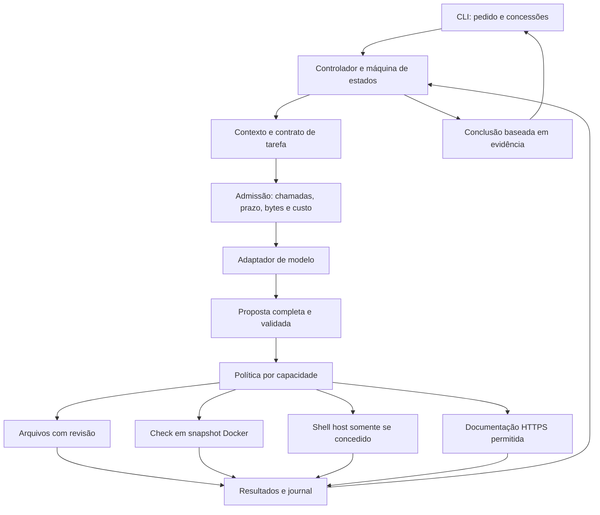

# 1. Arquitetura e organização que outro projeto deve implementar

## 1.1 A unidade de construção

Um sistema agente combina modelo, controlador, ferramentas, ambiente e verificação. O modelo produz decisões probabilísticas; o controlador transforma propostas em um fluxo com estado; executores produzem efeitos; a evidência permite avaliar o resultado. Esses componentes devem ser substituíveis por interfaces pequenas.

Escolhemos inicialmente um monólito modular em Node.js 24. As fronteiras são lógicas, não serviços de rede: isso reduz falhas distribuídas e permite testar o ciclo com um provedor controlado. O executor Docker já é uma fronteira de processo. O App Server também é um processo, mas é tratado como motor de inferência por nosso adaptador.



## 1.2 Estrutura mínima de destino

Um projeto pode reproduzir nossa estrutura atual ou separar diretórios quando os módulos crescerem. O que precisa ser preservado é a direção das dependências.

```text
meu-agente/
  AGENTS.md                      # entrada para agentes desenvolvedores
  REPLICAR.md                     # contrato de construção e reprodução
  package.json                   # engine, bin, scripts e dependências
  package-lock.json              # versões efetivamente instaladas
  yzzy.config.json                # configuração do operador
  YZZY.md                         # convenções do projeto
  bin/                           # CLI, opções e sessão interativa
  src/
    agent.js                     # ciclo e estados
    tools.js                     # schemas e política
    providers.js                 # contrato canônico de inferência
    codex-provider.js             # tradução do protocolo
    codex-rpc.js                  # processo e RPC
    workspace.js                 # leitura, revisão, escrita e snapshot
    executor.js                  # checks isolados
    host-shell.js                # concessão explícita do host confiável
    documentation.js             # consulta externa
    budget.js                    # reservas e uso
    journal.js                   # eventos e checkpoints
    memory.js                    # projeção do histórico
    profiles.js                  # instruções e preferências
    specialists.js               # procedimentos por domínio
    team.js                      # coordenação sequencial
    replication.js               # geração independente
  tests/                         # falhas e invariantes determinísticos
  evaluations/                   # tarefas, runner e avaliadores controlados
  scripts/                       # empacotamento, checks e smokes opt-in
  docs/
    replicacao/                  # como implementar, com spec rastreável
    codex/                       # integração e investigação pública
```

O nome de um diretório não impõe segurança. Uma variante em camadas pode separar `domain`, `application`, `adapters` e `infrastructure`; faça isso quando melhorar entendimento, propriedade e testes. Não crie uma pasta para cada conceito apenas para parecer uma arquitetura avançada.

## 1.3 Contratos canônicos

### Inferência

```text
generate({system, messages, tools, signal}) ->
  {text, calls:[{id,name,args}], usage?, resolvedModel?, billing?, native?}
```

O adaptador conhece o protocolo do fornecedor, mas não escreve no workspace. `native` pode conservar continuidade específica de API; não exponha conteúdo opaco como autoridade nem misture formatos de provedores diferentes. Respostas incompletas não viram execução.

### Política

```text
validateCall(name,args) -> aceita ou erro de schema
decide(name,args,permissions,config) -> {effect,reason}
```

A política vincula a capacidade à proposta efetiva. Validação de forma não resolve caminhos, rede ou efeitos; cada executor precisa validar seu domínio. A decisão é registrada antes de executar. O nosso primeiro produto tem `allow` e `deny`; aprovações dinâmicas assinadas seriam uma extensão, não uma característica escondida do booleano.

### Execução

```text
run(invocation,grant,signal) ->
  {ok,exitCode?,output?,truncated?,timedOut?,cleanupKnown?,error?,revision?}
```

Defina o que cada campo significa e quando um efeito pode ser desconhecido. Código de saída zero prova término bem-sucedido daquele processo sob suas regras; não prova que todo o pedido foi atendido. `run_command` é diagnóstico e possui autoridade mais ampla que `run_check`.

### Evidência

```text
Evidence = {id,command,revision,currentRevision,passed,cleanupKnown,...}
```

Uma evidência tem origem e revisão. Uma edição posterior invalida a ligação ao código final. Uma resposta do modelo com o nome de um teste não cria essa entidade. No destino, armazene referências grandes como artefatos quando o journal começar a crescer; isso exige controle de acesso e retenção próprios.

## 1.4 Estado e eventos são coisas diferentes

O estado canônico responde “onde estamos?”. O evento responde “o que aconteceu?”. Um checkpoint pode incluir objetivo, permissões, mensagens, contadores, evidências e operações pendentes. Um evento inclui sequência, tempo, correlação e dados da transição.

Nosso journal grava checkpoints completos por evento, uma escolha simples e custosa em armazenamento. Um destino maior pode usar snapshots periódicos e eventos menores. A mudança precisa preservar recuperação de cauda incompleta, autoridade e ausência de replay indevido. Uma migração para SQLite ou um workflow engine não resolve automaticamente essa semântica.

## 1.5 Fronteiras de confiança

| Fronteira | Dado que cruza | Regra executável |
| --- | --- | --- |
| Pessoa → CLI | Objetivo, configuração e flags | Validar entrada e congelar concessões da sessão. |
| Modelo → host | Proposta de ferramenta | Schema, política e argumentos antes de efeito. |
| Arquivo/site → contexto | Conteúdo não confiável | Não promover texto a permissão; preservar origem. |
| Host → worker Docker | Snapshot e comando cadastrado | Não montar home, credenciais, daemon ou checkout gravável. |
| Host → shell confiável | Comando livre | Concessão explícita; declarar ausência de confinamento e efeito potencial. |
| Ferramenta → verificador | Resultado observado | Conferir revisão e validade, sem aceitar autodeclaração do modelo. |
| Especialista → coordenador | Parecer | Autoria, escopo, limite e crítica; consenso não é prova. |

O shell confiável pode ler e alterar dados que as ferramentas restritas bloqueiam. Isso é uma mudança do modelo de confiança, não uma falha que um prompt de denylist possa corrigir. Para código não confiável, prefira worker isolado; para ambientes de usuário deliberadamente autorizados, use a concessão host e mantenha seu alcance visível.

## 1.6 Padrões úteis e quando aplicá-los

**Adapter:** traduz cada provedor para o contrato canônico. Útil porque autenticação, continuidade e ferramentas mudam por API. Um JSON genérico enviado a todos costuma perder correlação ou itens obrigatórios.

**Ports and adapters:** separa política e estado de infraestrutura. Útil para injetar um provedor e um runner controlados em testes. Nosso código usa funções e objetos simples; não precisa de um framework de injeção para ter essa propriedade.

**State machine:** torna perguntas, limitações e efeitos incertos explícitos. Útil para impedir que toda exceção seja tratada como “tente novamente”. Um enum sem transições verificadas não é uma máquina de estados completa.

**Strategy:** escolhe provedor, executor ou seleção de contexto mantendo contratos. Útil quando existem estratégias reais; não crie interfaces vazias para uma única função estável.

**Append-only journal:** conserva trajetória e facilita diagnóstico. Útil para retomar e investigar custo desconhecido. Hash encadeado detecta inconsistência, mas não autentica contra alguém que pode reescrever o arquivo e sua âncora.

**Supervisor/worker:** separa coordenação e execução. Útil para conter código gerado e credenciais. O shell do host rompe o confinamento do worker por escolha do operador; não apresente essa sessão como equivalente ao modo Docker.

**Saga/idempotência:** útil para efeitos externos que precisam compensação/reconciliação. Não implementamos esse mecanismo no runtime atual. Antes de adicionar publicação, compras ou infraestrutura, defina a identidade da operação e como consultar o destino após timeout.

## 1.7 O que a arquitetura atual não faz

Não há scheduler distribuído, ledger concorrente atômico, debugger JVM embutido, LSP, marketplace de plugins, servidor MCP próprio ou treinamento de pesos. O desenho permite acrescentar essas capacidades, mas sua presença na documentação não é uma implementação.

Para evoluir, registre uma decisão com problema, hipóteses, alternativas, opção, efeitos, migração e critério de reversão. O capítulo 7 compara caminhos atuais de plataforma; o capítulo 6 define como medir se uma extensão vale seu custo.
